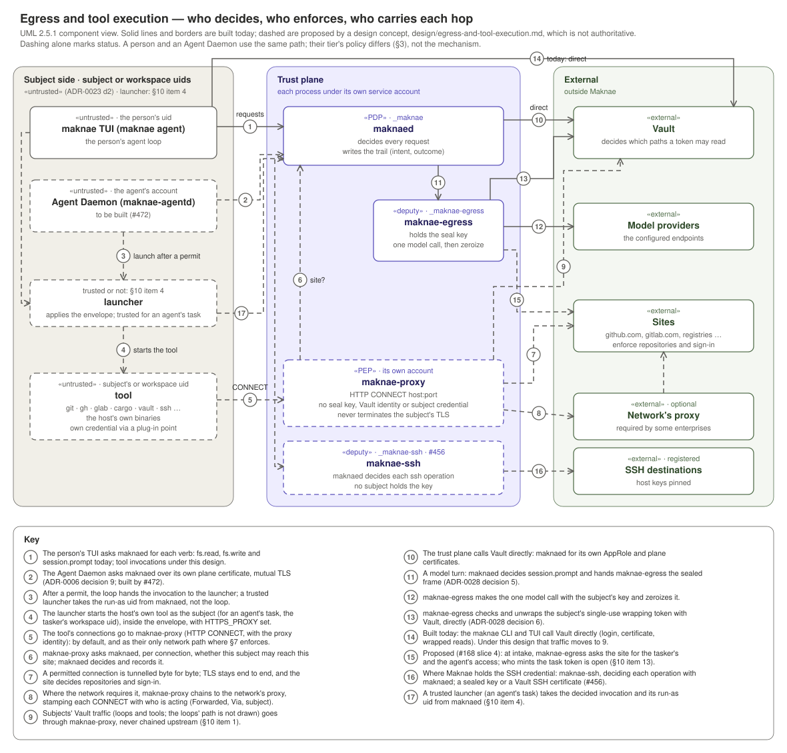

# Egress and tool execution: a design concept

| | |
|---|---|
| **Status** | **Design concept, not authoritative.** It records a direction from a design session with the maintainer on 2026-10-26. It decides nothing: the ADRs it leads to decide, and they may decide differently. Expect it to change, and to be wrong in places. Nothing here is built except what it cites as existing code or a merged slice. |
| **Date** | 2026-10-26 |
| **Bears on** | #168, #420, #456, #479 and the other artifacts listed in §11, none of which this concept amends. |

## 1. Thesis

**Maknae constrains a subject, an Agent Daemon or a person working in the `maknae` TUI, to follow policies that are defined and enforced out of band by the control plane, using the operating system's own configuration and enforcement points.**

Maknae will not rebuild the tools people work with. `git`, `gh`, `glab`, `cargo`, `rustc`, `python`, `terraform`, `ssh` and the `vault` CLI will run as themselves on the host, as the subject (or, for an agent's task, as the tasker's workspace uid, §3 decision 14). Maknae will decide whether each run it launches happens and inside what envelope, route those tools' connections through one enforcement point it controls, and record both. How far a subject can step around that, by running a tool outside Maknae or rerouting it, is bounded only by what the network enforces for that subject's account (§7). Today only the two file tools work this way (`read_file` and `write_file`, ADR-0023 decision 6).

## 2. Why this document exists

#168 slice 3 was to make the Egress Daemon call GitHub's REST API with the agent's credential. Mapping it showed that design was the start of a per-application rebuild: a GitHub REST frame, then git's smart-HTTP protocol, then GraphQL, then GitLab, then the next tool. Using Maknae as a coding agent, including for Maknae itself (`design/self-development.md`), needs every tool used to build, test and assess it to work through the platform, for a person and for an agent alike.

Two container models were weighed and rejected as the default. A single development-platform image needs rebuilding almost daily as toolchains and libraries move, and drifts from the host between rebuilds. An image per tool means hundreds of images to fetch, patch and pin. §8 keeps containers as a tier option.

This design also closes the brokering question that `admin.credential.broker` was struck over (#168, 2026-10-19). No trust-plane process lends a credential to a subject: each subject uses its own credential in its own processes (ADR-0028), and Maknae governs where its traffic may go.

## 3. Directions agreed

These are the directions the design session agreed on. They are not decisions: each becomes binding only through an ADR, and any of them may change. Where one states what exists today, it says so. The numbered items are called decisions below for reference.

1. **Maknae's site policy names sites, never repositories or site authentication.** The question the policy answers is "may this subject reach `github.com`?". Which repositories an account may touch, and how it authenticates, is the site's to enforce: GitHub already enforces repository permissions per account. A policy that names repositories cannot enumerate public ones and only duplicates the site. The one per-task repository scope Maknae sets is the intake intersection that decision 11 narrows a task's token to, which asks the site and keeps no list.
2. **Policy is tailored by deployment tier, and the install is the same at every tier.** The tiers are those of ADR-0008 and ADR-0022: HomeLab, Small/Medium Business and Enterprise. Those ADRs define a tier by its `handling` and ceiling; this design adds a second axis to the same tiers, the site-policy baseline. A tier will be a shipped policy baseline the operator selects, not a different build. An entity with higher requirements selects a stricter baseline or layers its own list onto it. No tier baseline ships today, and `destinations:` is default-deny for every role (§10, item 6).

   | Tier | People | Agent Daemon |
   |---|---|---|
   | HomeLab | allow, with a denylist | allowlist |
   | Small/Medium Business | allow, with a denylist | allowlist |
   | Enterprise | allowlist | allowlist |

   **The Agent Daemon gets an allowlist at every tier.**
3. **One credential per account per site, not per repository.** Measured 2026-10-26: one `gh` OAuth token (scopes `repo`, `read:org`, `gist`) reached all 163 repositories its account can reach (110 personal, 50 in one organization, 3 others). A fine-grained token belongs to one owner and can cover all of that owner's repositories, so a user who prefers them needs one per owner. The operator documentation will set this expectation.
4. **Tools are the host's own and run as the subject (for an agent's task, the tasker's workspace uid); the kernel decides each invocation Maknae launches and records it.** A tool the subject runs without the launcher is outside that decision, and only the network rule of §7 bounds it. This generalizes ADR-0023 decision 4, under which `read_file` and `write_file` already run this way: the kernel decides and durably records intent, the subject's process does the work, and the outcome is recorded. A tool invocation is decided as a whole (its program, arguments, working directory and envelope), not per system call and not per network packet.
5. **A tool is supported if it fits a contract, not a list.** It must (a) send its network traffic through a proxy named by `HTTPS_PROXY`, or by `ProxyCommand` for SSH, and (b) take its credential through a standard plug-in point. Maknae will ship adapters for credential protocols, not for applications: the git credential helper, token environment variables (`GH_TOKEN`, `GITLAB_TOKEN`, `VAULT_TOKEN`), cargo's credential provider, and `.netrc`. "Supported" means tested against the platform proxy, because proxy environment variables have no standard (§6.3).
6. **`maknae-proxy` is the platform's outbound policy enforcement point (PEP) for subjects.** The connections of tools Maknae launches will go through it by default, and it will be the only network path left to the tools Maknae launches where §7 enforces (for the agent, its account and its taskers' workspace uids; for a person, the slice), local services excepted (§7). It will be a separate process and service account from `maknae-egress`, holding no seal key and no Vault identity. Where the environment requires a network proxy, `maknae-proxy` chains to it.
7. **Standard OS configuration routes; the network layer enforces.** Maknae will ship system configuration (an `/etc/ssh/ssh_config.d/` drop-in and the Agent Daemon unit's environment), and the launcher will build each tool's environment from an allowlist, so tools use the proxy by default with no user effort. The system git configuration is not used for the proxy: it is one host-wide file (and lives elsewhere on macOS), and a proxy setting there would send every user's git, including git run outside Maknae with no proxy identity, to the proxy. Git gets its proxy (`http.proxy`) and credential helper from the launcher's environment (`GIT_CONFIG_COUNT`), with the helper list reset by an empty entry before `git-credential-maknae`. **All of this is a default, not a control.** Any setting or variable that the subject, a repository or a tool's own configuration controls can reroute a tool or undo the helper reset: for git, a URL- or remote-scoped proxy (`http.<url>.proxy`, `remote.<name>.proxy`, even an empty one, which means direct), `url.<base>.insteadOf`, `core.gitProxy`, `core.sshCommand`, `-c` and its environment form `GIT_CONFIG_PARAMETERS`; for SSH, `~/.ssh/config`, `-o` and `-F`; and each tool's own proxy settings (`CARGO_HTTP_PROXY`, `VAULT_PROXY_ADDR`, and the like). Building the environment from an allowlist removes the inherited variables, but the subject runs inside its own uid and can set them again. Where the tier requires it, enforcement is a network rule the subject's account cannot change (§7; for a person, under §7's conditions).
8. **The trust plane calls Vault directly; subjects reach Vault through the proxy.** Maknae decides that Vault is a reachable site. Vault decides which paths a token may read, through the policies Maknae ships in `deploy/vault-pki`. Reaching Vault never widens what a subject may read there (§5.3). Today the `maknae` CLI calls Vault directly, and `maknae-vault` refuses every ambient proxy: it scrubs all eight proxy variables and builds its client with `no_proxy()` (#318; `docs/configuration.md`). That refusal stays. A subject's Vault client gains exactly one proxy, `maknae-proxy`, whose address comes from Maknae's YAML configuration (ADR-0005 decision 8), never from the environment. That forks the subject's client from the trust plane's, which `maknae-vault` builds today as one client for every caller, and changes the source test that pins `no_proxy()` (`the_four_hardening_calls_are_present_and_the_merge_is_not`).
9. **Containers are a tier option, not the default** (§8).
10. **SSH has two paths.** Where Maknae holds the credential, SSH is `maknae-ssh` (#456): a trust-plane client under its own account, where `maknaed` decides each `ssh.exec` and `ssh.copy_*` operation, host keys are pinned, no subject's process ever holds the private key (`maknae-ssh`'s own account holds it, Vault issues a certificate, or it stays on a person's PKCS#11 token), and the credential provider varies by tier (a sealed key at HomeLab, a Vault SSH certificate authority at Enterprise, PKCS#11 for a person proving presence). The Agent Daemon uses this path only. A person's own `ssh`, with their own key, is routed through `maknae-proxy` by `ProxyCommand` at the tiers that allow it (§5.5).
11. **An agent reaches a code-hosting site as an app, with a token narrowed to each task.** The Agent Daemon's identity at GitHub (or GitLab) is an app installation, not a user account. At intake, the tasker's and the agent's access are intersected (#168 slice 4), and the agent receives installation tokens limited to the intersected repositories and permissions for that task. The site enforces the token's limits on every call, so Maknae parses none of the site's protocols. A GitHub installation token carries one set of permissions, applied to every repository it names, so a task whose operations need different permissions on different repositories (push on a pull request's head repository, comment on its base) either receives one token per permission set or is granted the union. Which, and what the token cannot express, are §10 item 13.
12. **Maknae owns the process level and attributes what it sends; the deployment owns the user and host level.** Maknae confines the tools it launches, not the person's whole account, under the conditions of §7. Where it chains to the network's proxy, it tells that proxy who is acting on each connection (§6.6), as a reverse proxy does for a cluster's inbound traffic with `X-Forwarded-For`.
13. **Installing Maknae changes nobody's traffic.** Every routing drop-in matches only invocations Maknae launched (a variable the launcher sets; anything else that sets it only misroutes itself) or enrolled agent accounts, and every network rule matches only an enrolled agent's account, its taskers' workspace uids, or a person's Maknae slice. The one exception is a person uid rule a deployment explicitly turns on (§7), which confines that person's whole account by the deployment's choice and is never enabled by installation. The drop-in's `Match exec` does run a check for every `ssh` on the host, which changes no route. A host with Maknae installed but no subject enrolled routes and blocks exactly as it did before; enrollment activates the rules for specific accounts, and disabling or removing Maknae restores the prior state. No interim phase may break a person's own `ssh`, `git` or browser.
14. **An agent's tools run under the tasker's workspace uid** (#420 decision 4, #476). In shared mode each tasker has a workspace uid; the tools the Agent Daemon launches for a task run under that tasker's workspace uid, the task's tokens are delivered there, and the network rule matches the workspace uids as well as the agent's own account. Work the Agent Daemon starts on its own runs under its own account. Starting a process as a workspace uid needs a privilege the untrusted Agent Daemon must not hold, so an agent's task tools are started by a trusted launcher (§10 item 4), which takes the decided invocation, its run-as uid included, from `maknaed`, never from the loop. Who assigns workspace uids, and how the network rule and the proxy learn them, is §10 item 19.

## 4. Subjects, processes and relationships

### 4.1 Processes

The table shows the target. `maknae-proxy`, the Agent Daemon, the launcher and the tool path do not exist yet. Today the CLI reaches Vault directly, and `maknaed` has no Agent Daemon socket (#472).

| Process | Runs as | Trust | Talks to | Holds |
|---|---|---|---|---|
| `maknaed` | `_maknae` | trusted: the sole PDP (ADR-0005) | the clients' socket; the Agent Daemon's socket (ADR-0006 decision 9); `maknae-egress`; `maknae-proxy`'s decision queries; the trusted launcher, for decided invocations; Vault, directly | its own AppRole and plane leaves; the trail |
| `maknae-egress` | `_maknae-egress` | trusted | inbound: `maknaed` only (peer uid `_maknae`); outbound: model providers and Vault, directly; the code-hosting site, for #168 slice 4's intake check | the seal key (ADR-0028 decision 6); a provider key for one call; the tasker's sealed site token for one intake check; any minting role §10 item 13 assigns |
| launcher (proposed) | untrusted for a person's tools; trusted for an agent's task tools (§10 item 4) | §10 item 4 | `maknaed`, for the decided invocation and its run-as uid | for an agent's task, the right to start a process as a workspace uid |
| `maknae-ssh` (#456, proposed) | `_maknae-ssh` | trusted | `maknaed` for decisions; registered SSH destinations, directly | a sealed SSH key (HomeLab) or a short-lived Vault SSH certificate (Enterprise) for one operation |
| `maknae-proxy` (new) | its own account | trusted PEP; holds no seal key and no subject credential (an upstream-proxy credential is §10 item 10) | subjects' tools (inbound); `maknaed` for decisions; permitted sites (outbound), or the network's proxy | no seal key, no Vault identity, no subject credential; a per-invocation proxy identity in passing |
| `maknae` CLI and TUI (`maknae agent`) | the person's uid | untrusted (ADR-0023 decision 2) | `maknaed`; Vault through the proxy | the person's Vault token, for its own reads |
| Agent Daemon (`maknae-agentd`, to be built by #472) | the agent's service account | untrusted | `maknaed` over its plane leaf; Vault through the proxy | its AppRole SecretID in OS custody (#168 slice 2) |
| A tool (`git`, `gh`, `cargo`, `vault`, …) | the person's uid, or for an agent's task the tasker's workspace uid | untrusted | sites through the proxy | the subject's own credential, for that invocation |
| Vault | its own host | external, trusted for identity | — | every subject's credentials, under per-subject policy |

`maknae-vault` is a library crate, not a process. It shapes and checks Vault calls inside `maknaed`, `maknae-egress`, the CLI, and the Agent Daemon.

### 4.2 Relationships

A person and an agent use the same mechanism. What differs is the policy their tier gives them (§3, decision 2) and how strictly the network enforces the proxy for them (§7).

## 5. Flows

§5.1 is how a model turn works today, with one change to come. §5.2 to §5.5 are not built.

### 5.1 A model turn

The subject makes a response-wrapped read of its own provider key under its own Vault identity (directly today; through `maknae-proxy` under this design), seals the wrapping token to `maknae-egress`, and sends `session.prompt`. `maknaed` decides, records intent, and hands the sealed frame to `maknae-egress`, which checks `creation_path`, unwraps, makes the one call directly to the provider, and zeroizes (ADR-0028 decisions 5 and 6). Model calls are meant to stay on this path because the trust plane must see their content and spend their credential. That is a convention, not yet a control: a subject can read its own provider key (ADR-0028) and reach the provider through the proxy wherever its tier permits the provider's host, skipping the frame checks. Whether the proxy refuses the configured provider hosts to subjects is §10 item 15. Proxy traffic can carry both (a `git push` carries code and a token), but inside TLS, where the proxy cannot see them.

### 5.2 A person runs a tool: `git push`

1. The TUI asks `maknaed` to run `git push` in the person's working directory. `maknaed` decides the invocation, records intent, and mints a per-invocation proxy identity.
2. The launcher starts `git` as the person, with the envelope applied and `https_proxy` and `HTTPS_PROXY` set to `http://maknae:<identity>@127.0.0.1:<port>`, and the same proxy and the credential helper given to git through `GIT_CONFIG_COUNT` (§3, decision 7).
3. `git` asks its credential helper. `git-credential-maknae` makes the person's own wrapped read of their GitHub token (through the proxy) and hands the token to `git` for this invocation.
4. `git` opens `CONNECT github.com:443` at the proxy. The proxy asks `maknaed` whether this subject may reach `github.com`; `maknaed` decides on the tier's policy and records the connection.
5. TLS runs end to end between `git` and GitHub. GitHub decides whether this account may push to this repository.
6. The launcher reports the exit status; `maknaed` records the outcome.

### 5.3 A person reads project secrets: the `vault` CLI

A person working on datacenter infrastructure reads server credentials (for example, a hypervisor cluster's) that they keep in Vault:

1. `maknaed` decides the `vault` invocation and records intent, as in §5.2.
2. `vault` uses a Vault token the person holds for that path, from their own `vault login`, through its standard plug-in point (`VAULT_TOKEN`, or `~/.vault-token`), under a policy an administrator grants for those secrets. Maknae's own userpass token is not used for this: its subtree answers only wrapped reads (ADR-0028 decision 4), and it lives in Maknae's own custody, not in `~/.vault-token`.
3. Its connection goes through the proxy, which asks `maknaed` only whether the Vault host is a reachable site.
4. Vault decides which paths the token may read.

`maknae-egress` is not involved. The token sits in the person's own process for the invocation. **This is a change of posture, not an existing residual.** ADR-0028 accepts that a subject's processes *can* read the subject's own key; this design makes holding a tool's credential the normal path, for people and for the agent. That reverses #168's stated end state ("it never holds that service's credential in its own processes on the normal path"), and the isolation contract's custody row changes with it. The ADR records it.

The same flow applies to an agent, with one consequence that is intended: the agent's AppRole policy grants only its own subtree (#168 slice 1), so the agent cannot read those secrets unless a Vault administrator grants it the path, out of band.

### 5.4 An agent is tasked: reviewing a pull request with `gh`

1. A tasker tasks the agent (`agent.task`, #475). Intake bounds the envelope and checks the repository intersection (#168 slice 4), which asks GitHub, not a list Maknae keeps.
2. The Agent Daemon asks `maknaed` to run `gh pr view …`. `maknaed` decides it on the **agent's** role and records intent.
3. The launcher starts `gh` as the tasker's workspace uid (§3, decision 14), with the task's installation token, narrowed at intake to the intersected repositories and permissions (§3, decision 11), through the `GH_TOKEN` adapter.
4. `gh` reaches `api.github.com` only through the proxy, which permits it only if the site is on the agent's allowlist. On Linux the agent's account and its taskers' workspace uids can reach nothing but the proxy, at every tier, except through local services that connect on their behalf (§7); on macOS that is advisory.
5. Posting the review is a separate grant (#480).

**What enforces repository scope and the post grant after intake.** The site, through the token. The kernel's per-invocation decision on `gh`'s arguments does not bind the agent, because the agent's own account can run any tool without the launcher, with any token it can reach; and the proxy sees only `api.github.com:443`. So a task's installation token can reach only the repositories it names, with only the permissions it carries: what runs under tasker A's workspace uid holds no token for B's private repository and none that can post. Four limits follow, each in §10 item 13. Every installation token can read public repositories. Posting a review needs `pull_requests: write`, which also lets the token approve, so refusing self-approval (#480) is not something the token can do. Whoever reaches a token holds its permissions: running each tasker's tools under that tasker's workspace uid (§3, decision 14) keeps another tasker's tokens out of that uid, but two concurrent tasks for one tasker share a uid, and if tokens reach the workspace through the untrusted Agent Daemon, the Agent Daemon holds every concurrent task's tokens; how tokens are delivered is §10 item 13. And a token in a tool's environment reaches every process the invocation spawns, including code from the repository under review (a build script, a git hook): a tasker who wrote that code could approve their own pull request as the app. Maknae never writes a task token to the workspace uid's files, but what a spawned process does with it is §10 item 13. If the Agent Daemon's account can write into a tasker's workspace, then while steered by tasker A it can plant a hook or build script that runs under B's workspace uid during B's next task, holding B's token (§10 item 19). The guarantee also assumes the app's private key is unreadable by the agent's account and the workspace uids; an agent that can read the key can mint an unrestricted token.

### 5.5 SSH

**Where Maknae holds the credential, SSH is `maknae-ssh`** (#456; §3, decision 10). It is a trust-plane tool under its own account, like `maknae-egress`: `maknaed` decides each operation (`ssh.exec`, `ssh.copy_to`, `ssh.copy_from`), destinations are registered with pinned host keys, forwarding is never enabled, and `ProxyJump` only when the PDP permits it, and the subject never holds the key or the connection. With a Vault SSH certificate authority as the credential provider, each decision gets a short-lived certificate, so the credentials in use are exactly what is configured in Vault. The Agent Daemon reaches SSH only this way; its own `ssh` has no permitted SSH site at the proxy.

**A person's own `ssh`, with their own key, is routed through the proxy** where the tier allows it. SSH has no proxy environment variable. It has `ProxyCommand` and `ProxyJump`, and git has `GIT_SSH_COMMAND` and `core.sshCommand`. Maknae will ship a connector, `maknae-ssh-connect %h %p`, which opens an HTTP `CONNECT` tunnel to `host:22` through `maknae-proxy` with the same identity, site policy and trail record as HTTPS. The proxy carries bytes only, so the SSH protocol and host-key verification stay end to end. A `ProxyCommand` in a packaged drop-in is the pattern libvirt ships today as `/etc/ssh/ssh_config.d/30-libvirt-ssh-proxy.conf` (libvirt's connector passes a file descriptor over VSOCK rather than tunnelling HTTP `CONNECT`). The Maknae drop-in selects only invocations Maknae launched (`Match exec` on a variable only the launcher sets), so a person's `ssh` outside Maknae is untouched (§3, decision 13). OpenSSH takes the first value it obtains and reads drop-ins in lexical order, so the file must sort before any drop-in that sets the same keys (on RHEL, `50-redhat.conf`).

**This route is advisory.** The person's own `-o`, `-F` or `~/.ssh/config` overrides it (§3, decision 7). **A permitted SSH site is a permit to everything it forwards to:** with `ProxyJump` through a permitted bastion, the inner hop rides inside the SSH session, and `ssh -D` or `-L` opens a full tunnel, none of which the proxy sees. `maknae-ssh` exists for the cases where that matters.

## 6. `maknae-proxy`

`maknae-proxy` does not exist yet; this section specifies it.

### 6.1 Identity

The proxy must know which subject and which invocation each connection belongs to. On Linux the kernel reports the owning uid of the peer socket on a loopback connection (`sock_diag`), which names the subject's account but not the invocation. So when `maknaed` permits an invocation, it also mints a per-invocation proxy identity. The launcher sets it as the **password** of the proxy URL's `userinfo`, under a fixed user name (`http://maknae:<identity>@127.0.0.1:<port>`, percent-encoded). A user name alone does not work: git treats a proxy URL with a user and no password as a request to prompt for one, which fails without a terminal and first asks every configured credential helper. RFC 3986 §3.2.1 deprecates a password in `userinfo` for display reasons; tools accept it, and the value is a short-lived opaque token, not a reusable password. Tools send it as `Proxy-Authorization: Basic …`, but git (through libcurl, with `http.proxyAuthMethod=anyauth`) sends it only after a challenge, so the proxy answers an unauthenticated `CONNECT` with `407` and `Proxy-Authenticate: Basic` (RFC 9110 §15.5.8), and keeps the connection open for the retry, since libcurl otherwise reconnects. `git-credential-maknae` answers only for the sites it serves and ignores git's `store` and `erase` requests for the proxy's own host and port, so by default the proxy identity is not persisted. A `-c credential.helper=…` given after the launcher's reset brings a user's helper back into the list, which is part of the residual below.

- **Opaque.** The value is random and names nothing; `maknaed` resolves it to the subject, role and invocation.
- **Bounded.** It is revoked when the invocation's outcome is recorded, which the untrusted launcher reports, and it expires after a bounded lifetime regardless; the expiry is the bound a subject cannot undo.
- **Bound to the peer.** `maknaed` records each invocation's run-as uid when it decides the invocation (the person's uid; for an agent's task, the tasker's workspace uid; for work the Agent Daemon starts on its own, the agent's account), as trust-plane state. On Linux the proxy refuses an identity whose recorded run-as uid does not match the connecting socket's owner uid. macOS has no equivalent check, so there the identity is a bearer token, a named gap (§10, item 8).
- **Treated as a credential.** It is zeroized and redacted in the trust plane's processes, and by default in the launcher, and never written to the trail or a trust-plane log.

**Residual:** the identity sits in the tool's environment, so every descendant inherits it (build scripts, git hooks, a background credential cache), and verbose tool output prints it (`curl -v` reports the proxy URL). Git also offers proxy credentials to its credential helpers and asks them to store one that worked, which is why the launcher resets git's helper list (§3, decision 7). Tool output can enter the model transcript and leave for the provider, and no category detector recognises the value. The bounded lifetime and the peer binding limit what a leaked identity is worth.

The `maknae` CLI's own Vault reads during a turn are not a launched tool, so they need an identity that is not per-invocation (§10 item 1).

### 6.2 Decision

The proxy is a PEP; `maknaed` is the PDP. The unit of decision is the `CONNECT` tunnel: one tunnel may carry many HTTP requests, which the proxy cannot see. Each `CONNECT` is decided against the subject's role and the tier's site policy, a denylist as well as an allowlist, and an allow-by-default permit is recorded like any other. `maknaed` accepts decision queries and connection outcomes only from the proxy's account (a peer-uid check, as `maknae-egress` has for `maknaed`), so a subject cannot query decisions or write connection records. #147's ruling 1 says egress is evaluated at every request, never cached. For tool traffic the proxy can decide only per tunnel, and per request inside the tunnel the decision falls to the site, within the token Maknae narrowed. Whether that satisfies the ruling, or tool traffic needs another enforcement point, is §10 item 18. Caching beyond the tunnel is §10 item 2.

### 6.3 Standards

| Standard | Governs |
|---|---|
| RFC 9110 §9.3.6 | the `CONNECT` method and when a tunnel is established |
| RFC 9110 §11.7 and §15.5.8 | `Proxy-Authorization`, `Proxy-Authenticate` and `407 Proxy Authentication Required` |
| RFC 9112 §3.2.3 | the authority-form request target (`CONNECT github.com:443`) |
| RFC 7617 | the Basic scheme that carries the proxy identity |
| RFC 3986 | the `userinfo` component of the proxy URL that tools parse |
| RFC 9113 §8.5 | HTTP/2 `CONNECT`, if accepted; the proxy starts with HTTP/1.1 `CONNECT` only |
| RFC 6066 §3 | TLS SNI, which the proxy does not rely on (below) |
| RFC 4559 | Negotiate (SPNEGO) authentication, which many enterprise proxies require of a chained client |
| RFC 7239 | the `Forwarded` header, which tells the upstream proxy where a request came from |
| RFC 9110 §7.6.3 | the `Via` header, which names each proxy a request passed through |

The SSH protocol (RFCs 4251–4254) is not implemented by Maknae: the connector carries bytes. `ProxyCommand` and `ProxyJump` are OpenSSH client behaviour, not standards.

`HTTPS_PROXY`, `HTTP_PROXY` and `NO_PROXY` have **no standard**. Tools differ on letter case and on `NO_PROXY` syntax, and curl reads only lowercase `http_proxy`, because a CGI program receives a request's `Proxy:` header as `HTTP_PROXY` (the class of flaw later named httpoxy). The launcher sets `https_proxy` and `HTTPS_PROXY` only. It does not set `HTTP_PROXY`, which would make tools send absolute-form `GET` requests to a proxy that accepts only `CONNECT`, so a tool that reads only the environment fails on a plain `http://` URL where the network enforces and goes direct where it does not. Git also applies the launcher's `http.proxy` to `http://` URLs and sends the absolute-form request to the proxy, so a plain `http://` remote fails for git at every tier. The launcher sets `NO_PROXY` and `no_proxy` explicitly to a minimal value, so an inherited value does not route around the proxy by default; the subject can set it again (§3, decision 7).

### 6.4 Security behaviour

- **Not an open relay.** Ports are part of a site's entry: a site is reachable only on the ports its entry names, with 443 the default and 22 only where SSH is permitted. The configured Vault address carries its own port (8200 by default).
- **No server-side request forgery.** Loopback, link-local (including the cloud metadata address `169.254.169.254`) and private ranges are refused, except for a site whose own entry names such an address: the configured Vault, and each internal site the policy names. A private address is never permitted tier-wide. The proxy resolves names itself, checks the resolved address, and connects to the address it checked, with no second resolution, which also closes DNS rebinding. A subject's tools get no direct DNS where the network enforces; local resolvers remain a path (§7).
- **Attribution upstream** (§6.6).
- **The upstream leg is a new channel** whose TLS version and floor #203 classifies.
- **Chaining weakens the address checks.** When `maknae-proxy` chains to the network's proxy, it sends `CONNECT host:port` by name, so the upstream proxy's own hostname policy still applies, and the upstream resolves the name. In that mode the proxy's address checks and its rebinding guarantee rest on its own resolution, which may differ from the upstream's (split-horizon DNS).
- **Vault is never chained upstream.** The Agent Daemon's SecretID and token are bound to the host's address (#168 slice 2). Through an upstream proxy, Vault would see the proxy's address, and the binding would either fail or have to widen to cover the proxy.
- **No interception.** The proxy decides on the `CONNECT` host and port and never terminates the subject's TLS, so it holds no subject credential in passing. An enterprise that inspects content does so with its own upstream proxy, to which `maknae-proxy` chains. Encrypted Client Hello will hide SNI over time; the proxy never claims to verify that the TLS destination matches the `CONNECT` target. **Residual:** a permitted site on a shared CDN can front another tenant of the same CDN (domain fronting), so a site entry permits whatever that CDN will route for the name.
- **No automatic retry of a tunnel.** The proxy never re-opens a `CONNECT` on a subject's behalf. A tool's own retry of a mutating call happens inside its TLS and is not a control Maknae holds over tool traffic; for model calls, #172 item 6 still applies.
- **A tunnel does not outlive its permit.** The proxy closes every tunnel opened under an identity when that identity is revoked or expires, and closes a tunnel when the subject's permit for its site is withdrawn by a policy change, as `maknaed` ends a connection at its leaf's expiry (ADR-0006 decision 9). Re-deciding open tunnels and task tokens when a role, an identity or a task's grant changes is §10 item 17.

### 6.5 Trail

Each connection is recorded as an intent/outcome pair (ADR-0019): the subject, the role, the invocation, the destination host and port, and the outcome with bytes and duration. Never the proxy identity, never a credential, and never content, which the proxy cannot see.

### 6.6 Attribution upstream

Maknae attributes what it controls. When `maknae-proxy` chains to the network's proxy, each `CONNECT` it sends is a plain HTTP request to that proxy, outside the tunnel's TLS, so it carries who is acting, the way a reverse proxy tells a cluster the original client with `X-Forwarded-For`:

- `Forwarded: for=<the host's address>` (RFC 7239) and `Via` (RFC 9110 §7.6.3), so the upstream sees that the request came through `maknae-proxy` on this host;
- the acting subject (the person's username, or the agent's id with its tasker's username) and the invocation's identifier, in a header whose name the deployment configures, because enterprise proxies differ on which header they accept from a trusted chained proxy.

The invocation identifier is the trail's, not the proxy identity of §6.1, so the upstream's logs can be joined to Maknae's trail and nothing secret leaves. Where there is no upstream proxy, no one on the path can be told, and the trail is the record. Destinations never see these values: the tunnel's contents are the subject's TLS.

## 7. Enforcement by tier and platform

`HTTPS_PROXY` and the system drop-ins are advisory: a tool can ignore them. Where the tier requires enforcement, the network will leave the proxy as the only network path for what it confines: the agent's account and its taskers' workspace uids, or a person's launched tools in their slice, local services excepted (below). None of this enforcement exists yet: Maknae ships no network ruleset today (#562 corrects the isolation contract's claim of one).

| Subject | HomeLab | Small/Medium Business | Enterprise |
|---|---|---|---|
| Person | advisory | advisory | enforced, with the conditions below (§10 item 4) |
| Agent Daemon | enforced | enforced | enforced |

On macOS every cell is advisory until §10 item 8 is settled.

**What a subject cannot bypass, and what it can.** The Agent Daemon and the TUI are untrusted (ADR-0023 decision 2), so a confinement applied by them to the tools they launch can be skipped by them. The layers they cannot skip are the ones the system applies to their account: operating-system DAC on the account's files, the mandatory access control domain (SELinux; the Agent Daemon has no domain of its own yet), a network rule keyed to the account's uid (`nftables` `meta skuid` on the output hook, or a network namespace), and Vault's policy on the account's identity. Landlock, which an unprivileged process applies to its own children (filesystem rules, and TCP connect by port only, not by address, from ABI 4 on Linux 6.7), is defence in depth when the launcher is untrusted. Whether the envelope is applied by a trusted launcher instead (for example a systemd transient unit carrying the envelope as unit properties) is open (§10).

**Two levels, two owners.** The user and host level (whether a person or machine may reach the network at all, and through what) belongs to the deployment: an enterprise's forced proxy, firewall and endpoint controls. Maknae does not rebuild it; for people, it may ship a uid rule as a tier option for a deployment that has none. The Agent Daemon's account and its taskers' workspace uids are different: on Linux, Maknae ships their uid rule at every tier, and that rule is what the Agent Daemon row of the table rests on. The process level belongs to Maknae: the tools Maknae launches, per subject and per invocation.

**Residual: egress through local services.** A rule on the subject's own sockets does not cover a local service the subject asks to connect for it, under the service's own account. The resolver is the obvious case (systemd-resolved's varlink socket, `nscd` or `sssd`, `mDNSResponder` on macOS), so an enforced subject can still tunnel data out through DNS. The mitigations are to deny such sockets to agent accounts and workspace uids in the mandatory access control domain, or to run tools in a network namespace with no resolver. Any other reachable local service that connects outward on request is the same class.

**A person's tools are confined by cgroup, not by uid.** A network rule keyed to a person's uid would confine all of their processes, including their work outside Maknae. Instead, each tool Maknae launches for a person runs in a dedicated systemd slice, and the network rule matches that slice. An `nftables` rule matching `socket cgroupv2` for the slice can limit it to the proxy's address and port; systemd's per-unit `IPAddressAllow=` is coarser, since allowing `127.0.0.1` admits every loopback service, not only the proxy. The rule resolves the slice when it loads, so the slice is persistent and each invocation runs beneath it. The person's other processes are untouched. This needs systemd, cgroup v2 and `nftables`, which RHEL 9 and 10 and Debian 12 and later ship by default.

**What the slice does and does not hold.** It keeps the sockets of a launched tool and its children on the proxy. It does not stop a launched tool from asking a process outside the slice, running as the same person, to do the work: `systemd-run --user`, the session bus, an existing `tmux` or `screen` server, `cron` and `at`, `ssh localhost`, or an editor's language server. A slice under the person's own user manager can also be left, because the person's processes may move themselves between their own cgroups. So the slice is a control only when a trusted launcher places the tool in it under the system manager, and the envelope denies those same-uid spawn and messaging surfaces (in the mandatory access control domain, or with Landlock); until then it is a default, and the Enterprise person cell above is conditional on both (§10 item 4). It never stops the person running a tool outside Maknae, which is the deployment's user-level control. A network namespace per invocation (stronger, but needing a bridge to the proxy and user namespaces, which hardened hosts may restrict) and a separate account per session (which would own every file the tools write) were considered and not chosen.

**macOS is a supported platform with a gap here.** There is no per-account network rule without a Network Extension content filter, which needs Apple entitlements, and `sandbox-exec` is deprecated (the isolation contract records that `sandbox_init` accepts only named profiles, so there is no sanctioned sandbox route for Maknae's daemons; the same limit applies to confining a tool). Until that is closed, proxy use on macOS is advisory for every subject, and this is a supported-platform gap, not a reduced-profile footnote.

## 8. Containers

| Option | Cost |
|---|---|
| One development-platform image | rebuilt almost daily; drifts from the host between rebuilds |
| One image per tool | hundreds of images to fetch, patch and pin |
| **Host tools, confined per invocation (the proposed default)** | no images: the toolchain is what the operator already maintains (`dnf`, `apt`, `brew`, `rustup`) |
| Containers by tier | an Enterprise may require approved images from its registry; upstream images (for example `rust:1.99.1`) are used where they fit |

Maknae launches no containers today. A container launched for a subject will still be a tool under §3: decided per invocation, its network through `maknae-proxy`, its credential through an adapter.

## 9. Prepared for attribute-based decisions

The base build will decide a site by role and tier. For model frames, ADR-0022 decides that the base build enforces the level and the non-public switch at egress (decisions 6 and 7) and `Declared` and `Region` categories (decision 10). Per-destination `handling` is #147's and is not built, and neither are categories; the ceiling operand is built. None of those checks could run on a proxied connection, because the proxy never sees content. So proxy sites are a destination class on which the base build's content checks do not run; this amends ADR-0022 decision 6 for tool traffic (which names GitHub, with `cui_permitted: false`, as a destination), and the ADR records it. The concrete residual it accepts: the read-time egress floor covers only `Declared` and `Region` categories, not the non-public switch, so non-public content a subject may read can leave by `git push` to a permitted site with no check. A classification extension compiled in later must be able to make the same decision on attributes (ADR-0020), with no change to the flows above, to the wire, or to the seam's contract: compiling one in is additive at the seam (ADR-0022 decision 8), and no `handling` field changes meaning (decision 7). That holds only if the primitives carry the attributes from the first release, because an extension can enforce a richer label over the primitives but cannot retrofit one onto primitives that never carried it (ADR-0022 decision 10). So the first release of the proxy will carry these:

- **Destination attributes.** A site's `handling` (its accredited level, releasability, and the sensitivity categories it may receive under ADR-0022 decision 10) will be declared per site in policy, recorded even where the base build does not enforce it. `destinations:` cannot express a site or its `handling` today (§10, item 6). The per-connection request carries the site's identity and its declared `handling` in the seam's resource bag. Absence is a named value, never a missing key (#147's discipline), so a site with nothing declared is distinguishable from one whose attributes were lost.
- **Subject attributes.** The subject bag of every proxy decision is populated the same way as every other request's, so attributes an extension supplies for the subject (clearance, releasability, compartments, need-to-know) reach the decision without a new path. The base build adds none of them (ADR-0022 decision 9 keeps clearance and need-to-know out of the kernel).
- **The connection is content-blind.** `maknae-proxy` never sees content, so no detector runs on tool traffic and no category is detected there. An attribute-based decision on tool traffic is therefore one of **destination dominance**: a subject may reach a site only if the site's accredited level and permitted categories dominate what the subject may be carrying. What "may be carrying" means for a tool invocation (the session's high-water mark, the invocation's working set, or the subject's clearance as an upper bound) is open (§10), and the trail record carries the fields any of the three answers needs.
- **The trail.** The connection's intent record carries the destination's declared `handling` alongside the decision, so the record means the same thing before and after an extension is compiled in.
- **The egress floor.** ADR-0022 decision 10 enforces `Declared` and `Region` categories at read against the intersection of the configured destinations' permitted sets. A site reachable through the proxy is a destination for that purpose. The floor is one intersection across all destinations. Under an allow-by-default tier (people at HomeLab and Small/Medium Business), the reachable set is effectively every site, whose permitted categories are empty unless declared. And a single allowlisted site with nothing declared, such as `github.com` on an agent's allowlist, empties the floor for every subject. Either way the floor would refuse every read of a categorized object, a person's own `maknae read` included. How sites enter the floor is open (§10, item 7), and it must be settled before any site is added to a destination set (breakdown item 2).
- **Model calls are unchanged.** `session.prompt` frames still carry content to `maknae-egress`, where ADR-0022's category detection and the ceiling operand decide them against the provider's `handling`.

## 10. Open items

1. **Subject traffic to Vault that is not a launched invocation:** the CLI's reads during a turn, `maknae login` and its certificate minting, and the Agent Daemon's AppRole login, plane-certificate signing and wrapped reads. Some of it happens before the subject has authenticated to `maknaed`, so it cannot carry an identity `maknaed` minted, and where §7 enforces on an account (the agent's, its taskers' workspace uids, or a person under a deployment-enabled uid rule), that account reaches nothing but the proxy; a person's CLI outside the slice is not confined. Candidate: on Linux, the proxy admits the configured Vault entry on the peer uid alone, which is an exception to the `407` challenge of §6.1 and must say which accounts it applies to and what the trail records as the invocation. macOS has no peer uid, so the candidate does not reach it.
2. **Per-connection decisions and #147 ruling 1:** whether the proxy may cache a decision for the life of an invocation, or must ask per connection.
3. **The exec verb:** its name, its operands (program, arguments, working directory, envelope), and the per-invocation trail record.
4. **The envelope and who applies it.** For a person's tools: an untrusted launcher with Landlock (skippable by the subject), or a trusted launcher (for example systemd transient units under the system manager); the answer may differ by tier. For an agent's task tools only a trusted launcher works, because they run as another uid (§3, decision 14). That launcher needs a uid-switching privilege or must ask a component that has one (for example the system manager starting a transient unit with `User=`). ADR-0009 decision 1 says "the daemon never assumes credentials", and its context records that `maknaed`'s unit drops all capabilities and sets `NoNewPrivileges=yes`, so uid switching is "structurally foreclosed, deliberately" for `maknaed`; a launcher inside `maknaed`'s unit is ruled out, and a separate component holding the privilege is a new trust-plane surface. ADR-0009 decision 10's blast-radius argument against `CAP_SETUID` on the gateway applies to it by analogy. Reconciling these is part of this item.
5. **`sh -c` as a tool.** It makes every command a tool. Proposed: an Enterprise-tier switch, off for agents by default.
6. **The `destinations:` grammar for sites,** defined once with #147. `destinations:` is default-deny for every role today and accepts only `provider:<name>`; people's allow-by-default at two tiers is a deliberate change of direction to record in the ADR.
7. **Attribute-based decisions:** how sites enter ADR-0022's egress floor, and what a content-blind connection "may be carrying" for destination dominance (§9).
8. **macOS:** per-account network enforcement and tool confinement (§7).
9. **A person's own SSH keys:** how a person's named key is used under Maknae when `~/.ssh` is denied to it, at the tiers that route a person's own `ssh` (§5.5). Keys Maknae holds are `maknae-ssh`'s (#456).
10. **Enterprise upstream chaining:** Negotiate (RFC 4559) authentication to the network's proxy.
11. **The credential adapters:** the first set, and the `~/.maknae` mapping from a site (and optionally an owner) to a KV subpath.
12. **The tested-tool matrix** that backs "supported" (§3, decision 5). Git is its first row.
13. **The agent's app identity** (§3, decision 11): where the app's private key is held, so that the agent cannot mint unrestricted tokens itself; which trust-plane process mints the task tokens (a Vault secrets engine that mints narrowed installation tokens is one candidate) and how they reach the launcher; one token per permission set or the union, when a task's operations need different permissions on different repositories; refusing self-approval (#480), which `pull_requests: write` cannot express, by the agent, by a tasker who reads a token from their workspace, or by tasker-written code that runs under the workspace uid while holding one; two concurrent tasks for one tasker, which share a workspace uid; every installation token's read access to public repositories; revoking a task's tokens when its outcome is recorded, and re-minting for a task that outlives a token's one-hour lifetime; and GitLab's closest equivalent (project or group access tokens minted per task), which needs measuring. #168 deferred measuring an app installation token's `permissions` block; this decision makes that measurement due.
14. **Attribution header names** (§6.6): which header names the configuration offers by default, and how the upstream proxy is told to trust them only from `maknae-proxy`; and, where the upstream proxy is reached over plain `http://`, that the subject's name and the invocation identifier cross the network in clear text.
15. **Model provider hosts at the proxy** (#429 detects the bypass after the fact, and its matching must exclude the wrapped reads credential adapters make): refuse the configured provider endpoints to subjects at every tier, so model traffic can only take the decided path (§5.1), or accept a subject's direct model egress as a residual.
16. **Trust-plane egress where the network mandates a proxy** (`maknae-vault` and `maknae-llm` both build their clients with `no_proxy()` today): whether `maknae-egress` and `maknaed` chain too, and how that squares with Vault never being chained (§6.4).
17. **Recomputing authority mid-task** (#420 decision 11; the mechanism under ADR-0024 decision 6's rule that a policy change re-decides intake in full): re-deciding open tunnels, and revoking or re-minting task tokens, when a role, an identity or a task's grant changes, beyond the site withdrawal §6.4 already covers.
18. **Zero trust per request for tool traffic** (#147 ruling 1). Per request inside a tunnel, the decision is the site's, within the token Maknae narrowed (NIST SP 800-207 places a policy enforcement point as close to the resource as possible). Options: accept per-invocation and per-tunnel decisions in Maknae with per-request decisions at the site, and amend the ruling for tool traffic; decrypt tool traffic at some tiers; or route the operations that need per-request decisions through purpose-built mediated tools, as `maknae-ssh` does for SSH.
19. **Workspace uids** (#420 decision 4, #476): who assigns and creates them (the kernel or the Agent Daemon); how the trusted launcher, the network rule's uid set and the proxy's run-as record learn each one when it is provisioned; whether the tasker can read the workspace uid's files, and whether the Agent Daemon's account can write them; whether a workspace uid is a kernel subject when it reaches `maknaed` or Vault (ADR-0024 decision 2); which uid the file tools (`read_file`, `write_file`) run as for an agent's task, and so which uid ADR-0009's descriptor delegation comes from; and whether workspace uids get their own SELinux domain.

## 11. What this would touch, and a possible breakdown

**Existing artifacts this would touch.** If the ADRs adopt this concept, these need reconciling. Each changes only when an ADR decides; nothing here amends them.

- **#168:** scope item 3 is replaced. The Egress Daemon does not add GitHub's `Authorization` header to the agent's calls. The rescope banner's item 2 (the agent has "its own GitHub account") changes: the agent is a GitHub (or GitLab) app. Scope item 1's KV secret is no longer the agent's GitHub credential; slice 1's policy still governs the agent's own subtree, and whether the app's key lives there is §10 item 13. Scope item 4 step 3's call "with the agent's credential" uses an installation token. Slice 3 becomes "the agent's task token through the `GH_TOKEN` and git credential adapters, with `github.com` on the agent's allowlist"; slice 4 keeps its intersection check in `maknae-egress`, and the narrowed task tokens are minted wherever §10 item 13 places it (in `maknae-egress`, that would amend ADR-0028 decision 6, which gives it no Vault identity). The end state ("never holds that service's credential in its own processes on the normal path") changes (§5.3): the agent holds a token, but only one narrowed to its task.
- **#479:** the `gh` tool is a host tool, run under the tasker's workspace uid (§3, decision 14), not a container by default.
- **#480:** posting is a permission the task token carries only when the task's grant includes it (§5.4). Refusing self-approval is not expressible in the token and is §10 item 13.
- These corrections are made in the bodies of #168, #420, #479, #480 and #539, with dated banners, when the ADR lands.
- **ADR-0023 decision 4** ("tool calls are executed as the subject"): generalized from two file tools to any tool, and, for an agent's task, executed as the tasker's workspace uid rather than the subject (§3, decision 14; §10 item 19).
- **ADR-0028:** extended. Subjects reach Vault through `maknae-proxy`; the trust plane stays direct.
- **ADR-0009 decision 1** ("the daemon never assumes credentials"; "the client process is the subject", and the kernel evaluates the operating system's stack for that subject): for an agent's task, the PDP decides on the agent's role while the operating system evaluates the tasker's workspace uid, a different principal; and the trusted launcher of §3 decision 14 needs the uid switching that ADR-0009's context records as structurally foreclosed for `maknaed` (all capabilities dropped, `NoNewPrivileges=yes`). **ADR-0009 decision 10** (no `CAP_SETUID` on the gateway) applies by analogy. Both are §10 item 4. **ADR-0024 decision 2** derives every subject from a uid, so whether a workspace uid is a kernel subject is §10 item 19.
- **#539** (settled 2026-10-19: "the Agent Daemon acts under its own identity (for example, HobiBot's own GitHub account)"; an operator's own credential "released to the Egress Daemon as under ADR-0028 and #168"): the agent's identity is an app (§3, decision 11), and a person's tool holds the person's own credential (§5.3). How an on-behalf-of-the-tasker mode composes with an app identity stays #539's.
- **#420's "What" line and decision 6** ("HobiBot's own GitHub account", settled 2026-10-19): amended by §3 decision 11.
- **ADR-0024 decision 6** (the agent's "own outbound identity per destination … HobiBot's own GitHub account"): amended by §3 decision 11; the agent's identity at a code-hosting site is an app. ADRs keep their history, so the amendment is dated in the ADR.
- **`maknae-vault`'s refusal of ambient proxies** (#318; `crates/maknae-vault/src/env.rs`, `http.rs`; `docs/configuration.md`): kept, and a subject's Vault client gains one configured proxy (§3, decision 8).
- **#168 scope item 5:** each outbound GitHub call was to be an intent/outcome pair carrying the operation and the effective permission, and `destinations:` was to gain a GitHub class. The proxy sees no operation, so the trail records each invocation (its program and arguments, as the launcher submitted them) and each `CONNECT` tunnel, and the effective permission is the task token's permission set; the destination class is a site (§10 item 6).
- **#172's banner** forwards #172's bounded-outbound, write-ahead and no-retry properties to #168 slice 3. Under this design, bounded and write-ahead hold per invocation and per tunnel (intent recorded before launch and before the tunnel opens); no-retry of a mutating call does not hold for tool traffic (§6.4) and is recorded as a residual. The banner is corrected when the ADR lands.
- **ADR-0023 decision 2** ("the loop … holds no egress credential"): the loop still holds no credential the trust plane spends; the tools it launches hold the subject's own credential for an invocation (§5.3). The ADR amends it.
- **`packaging/isolation-contract.md`:** the egress custody row changes with §5.3.
- **#147 ruling 1:** per-request evaluation is per tunnel for tool traffic; whether it is amended is §10 item 18.
- **#420:** decision 3 (the tool model) is answered by §3 decisions 4, 5 and 9: host tools by default, containers a tier option. Decision 4: where tools run is §3 decision 14; who assigns workspace uids stays open (§10 item 19). Decision 10 (parity between the launch decision and what is spawned) is a control only with a trusted launcher (§10 item 4). Decision 11 is §10 item 17.
- **#456 (`maknae-ssh`) and #457–#468:** kept, as the SSH path wherever Maknae holds the credential (§3, decision 10).
- **#476:** tools run under the tasker's workspace uid, and the network rule matches those uids.
- **#477:** scoped to the container tier option and the launch shape for host tools; the operation classifier in the Egress Daemon is dropped, because no Maknae process sees a tool's operations. #477's class for executing repository code (a separate, quota-bound class) bears on the token exposure of §5.4 and stays #477's.
- **#478 and #479:** #478 serves the container tier option; #479's `gh` tool is a host tool by default.
- **#481:** if §10 item 4 settles on a trusted systemd launcher, a launched tool runs in a unit that a per-task stop can kill without the agent's cooperation.
- **#175 and #176 (`terminal.*`):** the exec verb of §10 item 3 is proposed to be `terminal.create` and its siblings, not a new term. #175's ruling that execution isolation is undecided is answered in part by §3 decisions 9 and 14 and §7, and the rest is §10 item 4.
- **ADR-0023 decision 6** ("exactly two tools"): amended to any tool that fits the contract of §3 decision 5.
- **#263** (the outbound-destination drift gate) gains `maknae-proxy`'s and `maknae-ssh`'s outbound connections; **#116** (the CLI's Vault path) feeds §10 item 1; **#177** (`mcp.connect`) shares the site grammar of §10 item 6.
- **`container-architecture.md` §3.2:** the egress role is two processes, `maknae-egress` for model calls and `maknae-proxy` for subjects' connections.

**A possible breakdown**, each its own spec, plan and pull request:

1. An ADR recording §3, §6 and §7, the `destinations:` direction change, the custody change of §5.3, and the amendments §11 names: ADR-0022 decision 6, ADR-0023 decisions 2, 4 and 6, ADR-0024 decision 6, ADR-0028, and the ADR-0009 reconciliation of §10 items 4 and 19.
2. Site destinations (after §10 item 7 is settled): the `destinations:` grammar for sites with per-site `handling`, the tier baselines and how an operator selects one, the PDP's site decision, and the seam attributes of §9.
3. `maknae-proxy`: the process, its account and units, `CONNECT`, the per-invocation and session identities, the per-connection decision, the security behaviour of §6.4, the trail pair, and upstream chaining.
4. The exec verb and the launcher, with the envelope.
5. The system drop-ins, the SSH connector, and the per-tier network enforcement on Linux for people.
6. The credential adapters, the operator documentation for credentials (one per account per site), and the tested-tool matrix.
7. The Agent Daemon binary (#472), with its own SELinux domain and the network rule for its account and its taskers' workspace uids (with #476), which uses 2 to 6.
8. #168 slice 3 as rescoped above, then slice 4.

## 12. Gaps between this concept and today

Each statement this concept makes about something not yet built, and the breakdown item (§11) that would deliver it.

| Not yet true | Section | Item |
|---|---|---|
| Tools run as the subject, each invocation decided and recorded | §1, §3 decision 4 | 4 |
| A tier is a shipped, selectable policy baseline | §3 decision 2 | 2 |
| The agent has a site allowlist; people an allow-and-deny list by tier | §3 decision 2 | 2 |
| `destinations:` names sites, with per-site `handling` | §3 decision 2, §9 | 2 |
| The operator documentation sets the one-credential-per-account expectation | §3 decision 3 | 6 |
| Credential adapters (git helper, token variables, cargo provider, `.netrc`) | §3 decision 5 | 6 |
| "Supported" is backed by a tested-tool matrix | §3 decision 5 | 6 |
| `maknae-proxy` exists, holds no seal key or subject credential, and chains upstream | §3 decision 6, §6 | 3 |
| System drop-ins route tools to the proxy by default | §3 decision 7, §5.5 | 5 |
| Subjects reach Vault through the proxy | §3 decision 8, §5.1 | 3 |
| The SSH connector `maknae-ssh-connect` for a person's own `ssh` | §3 decision 10, §5.5 | 5 |
| `maknaed` serves an Agent Daemon socket and proxy decisions | §4.1 | 7, 3 |
| A per-invocation proxy identity, and the non-invocation identity §10 item 1 settles | §6.1 | 3 |
| Subjects' own Vault traffic (login, certificates, wrapped reads) admitted through the proxy | §3 decision 8, §10 item 1 | 3 |
| The launcher builds tool environments from an allowlist and resets git's credential helpers | §3 decision 7, §6.3 | 4 |
| Per-connection site decisions and the connection trail pair | §6.2, §6.5 | 3 |
| Ports, address ranges and DNS restricted at the proxy | §6.4 | 3 |
| The network leaves the proxy as the only network path for what §7 confines | §7 | 5 (people), 7 (the agent and workspace uids) |
| The Agent Daemon has its own SELinux domain | §7 | 7 |
| Containers as a tier option | §8 | after 4; not scheduled |
| Proxy decisions carry site and subject attributes; the trail records the site's `handling` | §9 | 2, 3 |
| The agent's `gh` review flow | §5.4 | 8, with #475 and #480 |
| The agent as an app, with a narrowed token minted per task | §3 decision 11, §5.4 | 8 |
| Attribution headers on chained `CONNECT` requests | §6.6 | 3 |
| Installing Maknae changes nobody's traffic until enrollment | §3 decision 13 | 5 |
| An agent's tools run under the tasker's workspace uid, started by a trusted launcher | §3 decision 14 | 4, 7, with #476 |
| A subject's Vault client uses the configured `maknae-proxy` and still refuses ambient proxies | §3 decision 8 | 3 |
| `maknae-ssh` as the SSH path where Maknae holds the credential | §3 decision 10, §5.5 | #456 |
| A person's launched tools confined by cgroup | §7 | 5 |
