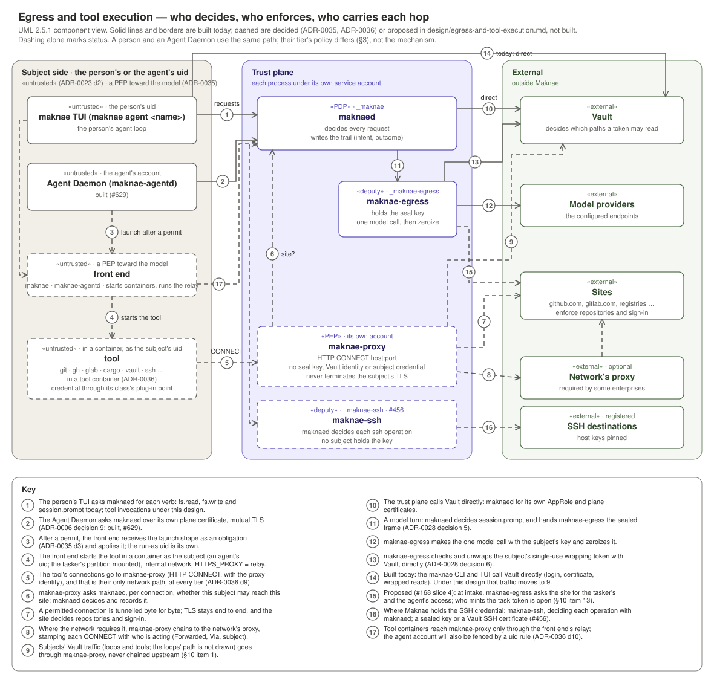

# Egress and tool execution: a design concept

| | |
|---|---|
| **Status** | **Design concept, partly decided.** It records a direction from design sessions with the maintainer on 2026-10-26 and 2026-11-18. [ADR-0035](adr/ADR-0035-policy-enforcement-points-placement-and-trust-tiers.md) (PEP placement), [ADR-0036](adr/ADR-0036-the-tool-model.md) (the tool model) and [ADR-0037](adr/ADR-0037-task-bindings-labels-and-tool-authorization.md) (task bindings, labels and tool authorization) decide what they cover, and this document follows them; where it goes further, it remains a direction that a later ADR decides. Nothing here is built except what it cites as existing code or a merged slice. |
| **Date** | 2026-10-26; brought to the current state 2026-11-19 |
| **Bears on** | #168, #420, #474, #456, #476, #477, #479 and the other artifacts listed in §11. ADR-0036 settles #420's decisions 3, 4, 10 and 12, retires #476, satisfies #477 and supersedes #168's scope item 3. ADR-0037 satisfies #474, settles #420's decision 2, satisfies #480, and adopts #168's scope item 4; §11 lists the rest. |

## 1. Thesis

**Maknae constrains a subject, an Agent Daemon or a person working in the `maknae` TUI, to follow policies that are defined and enforced out of band by the control plane, using the operating system's own configuration and enforcement points.**

Maknae will not rebuild the tools people work with. `git`, `gh`, `glab`, `cargo`, `rustc`, `python`, `terraform`, `ssh` and the `vault` CLI run as themselves, in a container the front end starts for each invocation, as the subject: a person's uid, or for an agent the agent's own uid, with each task's work confined to its tasker's partition (ADR-0036 decisions 1, 2 and 4). Maknae decides whether each invocation happens and inside what envelope, routes the tool's connections through one enforcement point it controls, and records both. Running a tool on the host instead (terminal mode) is configurable and disabled by default. Today only the model's file tools work through the kernel this way (`read_file`, `write_file`, `list_directory`, `stat_path`, `make_directory` and `delete_path`, ADR-0023 decision 6).

## 2. Why this document exists

#168 slice 3 was to make the Egress Daemon call GitHub's REST API with the agent's credential. Mapping it showed that design was the start of a per-application rebuild: a GitHub REST frame, then git's smart-HTTP protocol, then GraphQL, then GitLab, then the next tool. Using Maknae as a coding agent, including for Maknae itself (`design/self-development.md`), needs every tool used to build, test and assess it to work through the platform, for a person and for an agent alike.

Containers are the default (ADR-0036 decision 2). The two costs that once argued against them are answered by how images are built, not avoided by running on the host. A development image would need rebuilding almost daily as toolchains move: so the reference image carries the operating system and build tools only, and the Rust toolchain pinned by `rust-toolchain.toml` comes from a shared, read-only tools volume (ADR-0036 decision 17). An image per tool would mean hundreds of images: so one reference build image serves a language family, the image source stays configurable per tool, and a tool joins the known-acceptable list only after it is measured.

This design also closes the brokering question that `admin.credential.broker` was struck over (#168, 2026-10-19). No trust-plane process lends a credential to a subject: each subject's credential reaches its own tool container through a credential class (ADR-0036 decision 13), and Maknae governs where its traffic may go.

## 3. Directions agreed

These are the directions the design sessions agreed on. Where ADR-0035 or ADR-0036 decides one, it says so and cites the decision; the rest become binding only through an ADR. Where one states what exists today, it says so. The numbered items are called decisions below for reference.

1. **Maknae's site policy names sites, never repositories or site authentication.** The question the policy answers is "may this subject reach `github.com`?". Which repositories an account may touch, and how it authenticates, is the site's to enforce: GitHub already enforces repository permissions per account. A policy that names repositories cannot enumerate public ones and only duplicates the site. The one per-task repository scope Maknae sets is the intake intersection that decision 11 narrows a task's token to, which asks the site and keeps no list.
2. **Policy is tailored by deployment tier, and the install is the same at every tier.** The tiers are those of ADR-0008 and ADR-0022: HomeLab, Small/Medium Business and Enterprise. Those ADRs define a tier by its `handling` and ceiling; this design adds a second axis to the same tiers, the site-policy baseline. A tier will be a shipped policy baseline the operator selects, not a different build. An entity with higher requirements selects a stricter baseline or layers its own list onto it. No tier baseline ships today, and `destinations:` is default-deny for every role (§10, item 6).

   | Tier | People | Agent Daemon |
   |---|---|---|
   | HomeLab | allow, with a denylist | allowlist |
   | Small/Medium Business | allow, with a denylist | allowlist |
   | Enterprise | allowlist | allowlist |

   **The Agent Daemon gets an allowlist at every tier.**
3. **A stored credential is one per account per site, not per repository.** Measured 2026-10-26: one `gh` OAuth token (scopes `repo`, `read:org`, `gist`) reached all 163 repositories its account can reach (110 personal, 50 in one organization, 3 others). A fine-grained token belongs to one owner and can cover all of that owner's repositories, so a user who prefers them needs one per owner. The operator documentation will set this expectation. Minted credential classes (a GitHub App installation token, a GitLab project access token, a Vault child token, a Vault dynamic secret) are per task or per invocation instead (ADR-0036 decision 13).
4. **Tools run in a container by default, as the subject, and the kernel decides each invocation and records it** (ADR-0036 decisions 1 and 2). The front end asks `maknaed`, starts the decided container under its own uid, and reports the outcome. For an agent the subject is the agent's own uid, with each task's own directory within its tasker's partition the only workspace mount (ADR-0036 decision 4). This extends ADR-0023 decision 4, under which the model's file tools already run this way: the kernel decides and durably records intent, the subject's process does the work, and the outcome is recorded. A tool invocation is decided as a whole (its program, arguments, working directory and envelope), not per system call and not per network packet. A tool the subject runs outside Maknae is outside that decision.
5. **A tool is supported if it fits a contract, not a list.** It must (a) send its network traffic through a proxy named by `HTTPS_PROXY`, or by `ProxyCommand` for SSH, and (b) take its credential through a standard plug-in point. Maknae will ship adapters for credential protocols, not for applications: the git credential helper, token environment variables (`GH_TOKEN`, `GITLAB_TOKEN`, `VAULT_TOKEN`), cargo's credential provider, and `.netrc`. "Supported" means tested against the platform proxy in the tool's image, because proxy environment variables have no standard (§6.3). The image contract is ADR-0036 decision 16.
6. **`maknae-proxy` is the platform's outbound policy enforcement point (PEP) for subjects, and the only network path of a tool container** (ADR-0036 decision 9). A tool container sits on an internal network whose only route is the front end's relay to `maknae-proxy`; on Kubernetes, a NetworkPolicy allows egress only to the proxy. `maknae-proxy` is a separate process and service account from `maknae-egress`, holding no seal key and no Vault identity. Where the environment requires a network proxy, `maknae-proxy` chains to it.
7. **The front end builds each tool's environment; the container's network enforces.** The front end builds the tool's environment from an allowlist, so tools use the proxy with no user effort. Git gets its proxy (`http.proxy`) and credential helper from that environment (`GIT_CONFIG_COUNT`): the helper list is reset by an empty entry, then git's own `store` helper is pointed at a read-only credential file the front end mounts (ADR-0036 decision 13). No Maknae binary runs inside the image. Inside a container, a setting that reroutes a tool (`http.<url>.proxy`, `url.<base>.insteadOf`, `core.gitProxy`, `-c`, `GIT_CONFIG_PARAMETERS`, `CARGO_HTTP_PROXY`, `VAULT_PROXY_ADDR` and the like) reaches nothing, because the container has no other route. In terminal mode (disabled by default) all of this is a default, not a control: the subject runs inside its own uid and can set those again, and enforcement is a network rule the subject's account cannot change (§7). Maknae ships no system git configuration for the proxy: it is one host-wide file (and lives elsewhere on macOS), and a proxy setting there would send every user's git, including git run outside Maknae with no proxy identity, to the proxy.
8. **The trust plane calls Vault directly; subjects reach Vault through the proxy.** Maknae decides that Vault is a reachable site. Vault decides which paths a token may read, through the policies Maknae ships in `deploy/vault-pki`. Reaching Vault never widens what a subject may read there (§5.3). Today the `maknae` CLI calls Vault directly, and `maknae-vault` refuses every ambient proxy: it scrubs all eight proxy variables and builds its client with `no_proxy()` (#318; `docs/configuration.md`). That refusal stays. A subject's Vault client gains exactly one proxy, `maknae-proxy`, whose address comes from Maknae's YAML configuration (ADR-0005 decision 8), never from the environment. That forks the subject's client from the trust plane's, which `maknae-vault` builds today as one client for every caller, and changes the source test that pins `no_proxy()` (`the_four_hardening_calls_are_present_and_the_merge_is_not`).
9. **Containers are the default; terminal (host) execution is configurable and disabled by default** (ADR-0036 decision 2, §8).
10. **SSH has two paths.** Where Maknae holds the credential, SSH is `maknae-ssh` (#456): a trust-plane client under its own account, where `maknaed` decides each `ssh.exec` and `ssh.copy_*` operation, host keys are pinned, no subject's process ever holds the private key (`maknae-ssh`'s own account holds it, Vault issues a certificate, or it stays on a person's PKCS#11 token), and the credential provider varies by tier (a sealed key at HomeLab, a Vault SSH certificate authority at Enterprise, PKCS#11 for a person proving presence). The Agent Daemon uses this path only. A person's own `ssh`, with their own key, is routed through `maknae-proxy` by `ProxyCommand` at the tiers that allow it (§5.5).
11. **An agent reaches a code-hosting site as an app, with a token narrowed to each task.** The Agent Daemon's identity at GitHub (or GitLab) is an app installation, not a user account; this is the default credential class for GitHub at every tier, with a machine-user account and a stored token as the fallback (ADR-0036 decision 13). At intake, the tasker's and the agent's access are intersected (#168 slice 4), and the agent receives installation tokens limited to the intersected repositories and permissions for that task. The site enforces the token's limits on every call, so Maknae parses none of the site's protocols. A GitHub installation token carries one set of permissions, applied to every repository it names, so a task whose operations need different permissions on different repositories (push on a pull request's head repository, comment on its base) either receives one token per permission set or is granted the union. Which, and what the token cannot express, are §10 item 13.
12. **Maknae owns the process level and attributes what it sends; the deployment owns the user and host level.** Maknae confines the tools it launches, in their containers, not the person's whole account. Where it chains to the network's proxy, it tells that proxy who is acting on each connection (§6.6), as a reverse proxy does for a cluster's inbound traffic with `X-Forwarded-For`.
13. **Installing Maknae changes nobody's traffic.** Every routing drop-in matches only invocations Maknae launched (a variable the front end sets; anything else that sets it only misroutes itself) or enrolled agent accounts, and every network rule matches only an enrolled agent's account, or a person's terminal-mode slice where a deployment enables terminal mode. The one exception is a person uid rule a deployment explicitly turns on (§7), which confines that person's whole account by the deployment's choice and is never enabled by installation. The drop-in's `Match exec` does run a check for every `ssh` on the host, which changes no route. A host with Maknae installed but no subject enrolled routes and blocks exactly as it did before; enrollment activates the rules for specific accounts, and disabling or removing Maknae restores the prior state. No interim phase may break a person's own `ssh`, `git` or browser.
14. **An agent's tools run as the agent's own uid, and taskers are separated by partition** (ADR-0036 decision 4). A tasked tool's workspace mount is the task's own directory within its tasker's partition, never the whole partition (`tasks/users/<uid>` or `tasks/agents/<id>`, the partition operand of ADR-0008). There are no per-tasker workspace uids and no trusted launcher: starting a process as another uid needs a privilege the untrusted Agent Daemon must not hold, and the partition gives the separation without it. Work the Agent Daemon starts on its own runs under its own account too.

## 4. Subjects, processes and relationships

### 4.1 Processes

The table shows the target. `maknae-proxy`, the relay and the tool path do not exist yet. Today the CLI reaches Vault directly.

| Process | Runs as | Trust | Talks to | Holds |
|---|---|---|---|---|
| `maknaed` | `_maknae` | trusted: the sole PDP (ADR-0005) | the clients' socket; the Agent Daemon's socket (ADR-0006 decision 9); `maknae-egress`; `maknae-proxy`'s decision queries; Vault, directly | its own AppRole and plane leaves; the trail |
| `maknae-egress` | `_maknae-egress` | trusted | inbound: `maknaed` only (peer uid `_maknae`); outbound: model providers and Vault, directly; a forge's API, for the reach check at task submission and for minting (ADR-0038) | the seal key (ADR-0028 decision 6); a provider key for one call; a tasker's forge token, or a stored-token agent's, for one reach exchange; an installation-wide `metadata: read` token for one coverage listing, revoked at once |
| `maknae-ssh` (#456, proposed) | `_maknae-ssh` | trusted | `maknaed` for decisions; registered SSH destinations, directly | a sealed SSH key (HomeLab) or a short-lived Vault SSH certificate (Enterprise) for one operation |
| `maknae-proxy` (new) | its own account | trusted PEP; holds no seal key and no subject credential (an upstream-proxy credential is §10 item 10) | the front ends' relays (inbound); `maknaed` for decisions; permitted sites (outbound), or the network's proxy | no seal key, no Vault identity, no subject credential; a per-invocation proxy identity in passing |
| `maknae` CLI (`maknae -p`; the agent session `maknae agent <name>`) | the person's uid | untrusted toward its user (ADR-0023 decision 2); a PEP toward the model's tool calls (ADR-0035 decision 1) | `maknaed`; Vault through the proxy; starts tool containers and runs their relay | the person's Vault token, for its own reads; a delivered tool credential for one invocation |
| Agent Daemon (`maknae-agentd`) | the agent's service account | untrusted toward its user; a PEP toward the model's tool calls | `maknaed` over its plane leaf; Vault through the proxy; starts tool containers and runs their relay | its AppRole SecretID in OS custody (#168 slice 2); each running task's delivered tool credentials |
| A tool (`git`, `gh`, `cargo`, `vault`, …) | in a container, as the person's uid or the agent's uid | untrusted | `maknae-proxy`, through the relay only | the credential its class delivered, for that invocation |
| Vault | its own host | external, trusted for identity | — | every subject's credentials, under per-subject policy |

`maknae-vault` is a library crate, not a process. It shapes and checks Vault calls inside `maknaed`, `maknae-egress`, the CLI, and the Agent Daemon.

### 4.2 Relationships

A person and an agent use the same mechanism. What differs is the policy their tier gives them (§3, decision 2), and that an agent's account will also be fenced by a network rule on its uid once it is built (§7).

## 5. Flows

§5.1 is how a model turn works today, with one change to come. §5.2 to §5.5 are not built.

### 5.1 A model turn

The subject makes a response-wrapped read of its own provider key under its own Vault identity (directly today; through `maknae-proxy` under this design), seals the wrapping token to `maknae-egress`, and sends `session.prompt`. `maknaed` decides, records intent, and hands the sealed frame to `maknae-egress`, which checks `creation_path`, unwraps, makes the one call directly to the provider, and zeroizes (ADR-0028 decisions 5 and 6). Model calls are meant to stay on this path because the trust plane must see their content and spend their credential. That is a convention, not yet a control: a subject can read its own provider key (ADR-0028) and reach the provider through the proxy wherever its tier permits the provider's host, skipping the frame checks. Whether the proxy refuses the configured provider hosts to subjects is §10 item 15. Proxy traffic can carry both (a `git push` carries code and a token), but inside TLS, where the proxy cannot see them.

### 5.2 A person runs a tool: `git push`

1. The model, in the person's `maknae` session, asks for `git push` in the person's workspace (`current` or `path`, ADR-0036 decision 5). The front end asks `maknaed`, which decides the invocation and the workspace mount (the person's `Write` and `Read` grants over the subtree for a read-write mount), records intent, mints a per-invocation proxy identity, and returns the launch shape as an obligation carrying the mask set: the host and personal `sensitive.yaml` lists and the denies that win under the workspace (the site floor and the person's own) (ADR-0036 decisions 5 and 6).
2. The front end starts `git` in its container, as the person, on an internal network, with the workspace mounted (protected folders masked) and `https_proxy` and `HTTPS_PROXY` set to `http://maknae:<identity>@<gateway>:<port>`, the relay it runs on that network's gateway address (§6.1). The same proxy, and git's `store` helper over a read-only credential file, reach git through `GIT_CONFIG_COUNT` (§3, decision 7).
3. `git` asks its credential helper, git's own `store` helper, which reads the credential the person's credential class delivered for this invocation from the read-only file (ADR-0036 decision 13).
4. `git` opens `CONNECT github.com:443` through the relay. The proxy asks `maknaed` whether this subject may reach `github.com`; `maknaed` decides on the tier's policy and records the connection.
5. TLS runs end to end between `git` and GitHub. GitHub decides whether this account may push to this repository.
6. The front end reports the exit status and the output, with every credential value it delivered redacted (ADR-0036 decision 14); `maknaed` records the outcome, and the output reaches the model only in its next model turn, which `maknaed` decides (ADR-0023 decision 3).

### 5.3 A person reads project secrets: the `vault` CLI

A person working on datacenter infrastructure reads server credentials (for example, a hypervisor cluster's) that they keep in Vault:

1. `maknaed` decides the `vault` invocation and records intent, as in §5.2.
2. The front end mints a **Vault child token** from the person's own Vault token (from their own `vault login`), with the policy subset the tool's credential class names and a TTL equal to the invocation's timeout (ADR-0036 decision 13). Vault only lets a child hold a subset of its parent's policies, so if the person lacks the policy, minting fails and the invocation is denied. The container receives only the child token, as `VAULT_TOKEN`; the person's own token never enters it. Maknae's own userpass token is not used for this: its subtree answers only wrapped reads (ADR-0028 decision 4), and it lives in Maknae's own custody, not in `~/.vault-token`.
3. Its connection goes through the proxy, which asks `maknaed` only whether the Vault host is a reachable site.
4. Vault decides which paths the child token may read.
5. The entry's output to the model is `status_only` (ADR-0036 decision 14): the model learns whether the read succeeded, never the secret.
6. The child token is revoked when the outcome is recorded.

`maknae-egress` is not involved. **This is a change of posture, not an existing residual.** ADR-0028 accepts that a subject's processes *can* read the subject's own key; this design makes delivering a tool's credential to the tool the normal path, for people and for the agent, while redacting it from what the model sees (ADR-0036 decision 14, with its residual). That reverses #168's stated end state ("it never holds that service's credential in its own processes on the normal path"), and the isolation contract's custody row changes with it. ADR-0036 decision 13 records it.

The same flow applies to an agent, with one consequence that is intended: the agent's AppRole policy grants only its own subtree (#168 slice 1), so the agent cannot read those secrets unless a Vault administrator grants it the path, out of band.

### 5.4 An agent is tasked: reviewing a pull request with `gh`

1. A tasker tasks the agent (`session.task`) with a link to the pull request. The tasker's client binds it to a `git` forge its tool catalog names (server, base repository and change), and after submission echoes what the kernel sealed; a link to any other host is not bound, and the echo says why (ADR-0037 decisions 2 and 3). Intake re-validates the binding, refuses one whose server is not the host of a `git` forge in `forges:`, runs the reach exchange below, and seals the binding, the head repository GitHub reports for the change, and the observed `reach` into the task. The tasker's client echoes each binding with its effective reach. Nothing consumes `reach` yet: the hand-out mint and the per-call decision that will read it are #168 PR C and #479.
2. The Agent Daemon asks `maknaed` to run `gh pr view …`. `maknaed` decides it on the **agent's** role and records intent.
3. The Agent Daemon starts `gh` in its fetch entry's container (ADR-0036 decision 8), as the agent's uid, with only the task's own directory within its tasker's partition mounted (§3, decision 14), and with the task's installation token, minted at hand-out for the bound repositories at the intersected permissions (§3, decision 11), through the `GH_TOKEN` adapter.
4. `gh` reaches `api.github.com` only through the relay and the proxy, which permits it only if the site is on the agent's allowlist. The container has no other route, and on Linux the agent's account can reach nothing but the proxy, at every tier, except through local services that connect on its behalf (§7).
5. Building or testing the pull request's code runs in a separate entry with no network and no credential (ADR-0036 decision 8).
6. Posting the review is a separate grant, and each review decision is its own shape (ADR-0037 decision 9; #480). Merging is a separate act (#676).

**The reach exchange at submission** (ADR-0037 decision 7, amendment 2026-11-24). It asks GitHub, never a list Maknae keeps, and runs on the egress socket as `EgressFrame::Reach` frames, after `maknaed` has decided `session.task` and sealed the bindings, and before the task is stored. Each frame carries one server, at most 8 asks (a base repository, an optional change, and for the agent side the head the tasker side resolved) and `deadline_ms`, the time left of `egress.reach_deadline_ms`; `maknaed` records an intent before each frame and its outcome after it. The Egress Daemon admits a frame only for a server that `minting.yaml` `apis:` maps to the frame's provider, before any I/O.

- **The tasker frame**, one per bound GitHub server. It carries the tasker's sealed forge token: the tasker stored it with `maknae forge login`, and the client read it, response-wrapped, with the person's own Vault login and sealed the wrapping token under `maknae-seal-aad-forge-v1`. The Egress Daemon checks that the frame's path and field are the tasker's own, opens the seal, unwraps the token, and calls `GET /repos/{base}` (the role from its five `permissions` booleans), and for a change `GET /repos/{base}/pulls/{n}` (the head repository) and `GET /repos/{head}` (whether the tasker can push there). It needs neither Vault Transit nor a minter. Any answer but 200 refuses the task, and so does a missing or expired login.
- **The agent frame**, one per bound GitHub server, carrying the agent's observed credentials (its granted `github-app-installation` entries). The Egress Daemon has Transit sign one App JWT and reads `GET /app/installations/{id}` (the App's granted permissions; a suspended installation refuses); mints one installation-wide token holding only `metadata: read`; lists `GET /installation/repositories` with it, up to 10 pages of 100; and revokes it with `DELETE /installation/token`. A base the listing does not name is not covered, which gives the agent side nothing rather than refusing. The token is revoked on every exit, the deadline included, and never leaves the Egress Daemon. An agent with no App on that host, or a host whose minter is not ready, answers `NoForgeCredential` with no I/O.

`maknaed` intersects the two per binding, per side and per operation, and seals the result. A sub-task sends no tasker frame: its tasker side is its parent's sealed effective reach. At most 4 exchanges run at once on each side of the socket, and they are not counted in the prompt breaker, so a slow forge never refuses a model prompt.

*Ruled 2026-11-26 ([ADR-0037](adr/ADR-0037-task-bindings-labels-and-tool-authorization.md) decision 7 and [ADR-0033](adr/ADR-0033-agent-identity-admission-and-tasks.md), amendments 2026-11-26; not built): the Egress Daemon computes the intersection and returns it with both sides. A side whose credential is a stored token (`github-machine-user`) is observed through `forge_auth` on the agent's notice poll, after the task is stored `AwaitingReach` and before it is claimable, rather than being `NoForgeCredential`.*

**What enforces repository scope and the post grant after intake.** The site, through the token. The kernel's per-invocation decision on `gh`'s arguments binds the model, not a compromised Agent Daemon, whose own account can run any tool without asking the kernel, with any token it can reach; and the proxy sees only `api.github.com:443`. So a task's installation token can reach only the repositories it names, with only the permissions it carries: a container running tasker A's task holds no token for B's private repository and none that can post. Four limits follow, each in §10 item 13. Every installation token can read public repositories. Posting a review needs `pull_requests: write`, which also lets the token approve, so a token minted to comment can approve if a process outside the kernel's decision uses it. Whoever reaches a token holds its permissions: each container receives only its own task's token, but the Agent Daemon receives and delivers them, so it holds every running task's tokens. And a token in a tool's environment reaches every process the invocation spawns, including code from the repository under review (a build script, a git hook): a tasker who wrote that code could approve their own pull request as the app. Keeping code execution in an entry with no credential (ADR-0036 decision 8) keeps the credential out of the build's and tests' own processes. It does not close the path: build-time code can write workspace configuration (a hook, `.git/config`) that a later fetch-entry invocation in the same task honors while holding the token, and a pull request can ship configuration git or cargo honors. So self-approval by the pull request's author stays a named residual of ADR-0036 decision 8, bounded by the token's narrowing and lifetime, and a site that lists those paths in `sensitive.yaml` has them masked at each launch. A container mounts only its own task's directory within the tasker's partition, and the build-output cache is per task and the registry cache per tasker (ADR-0036 decision 12), so code running for one task cannot plant a hook in another tasker's partition or poison a later task's build output through the mount. The guarantee also assumes the app's private key is unreadable by the agent's account; an agent that can read the key can mint an unrestricted token.

### 5.5 SSH

**Where Maknae holds the credential, SSH is `maknae-ssh`** (#456; §3, decision 10). It is a trust-plane tool under its own account, like `maknae-egress`: `maknaed` decides each operation (`ssh.exec`, `ssh.copy_to`, `ssh.copy_from`), destinations are registered with pinned host keys, forwarding is never enabled, and `ProxyJump` only when the PDP permits it, and the subject never holds the key or the connection. With a Vault SSH certificate authority as the credential provider, each decision gets a short-lived certificate, so the credentials in use are exactly what is configured in Vault. The Agent Daemon reaches SSH only this way; its own `ssh` has no permitted SSH site at the proxy.

**A person's own `ssh`, with their own key, is routed through the proxy** where the tier allows it. In a tool container it has no other route anyway (ADR-0036 decision 9), and the connector below is how it opens its tunnel; the drop-in routing applies to terminal mode, where it is advisory. SSH has no proxy environment variable. It has `ProxyCommand` and `ProxyJump`, and git has `GIT_SSH_COMMAND` and `core.sshCommand`. Maknae will ship a connector, `maknae-ssh-connect %h %p`, which opens an HTTP `CONNECT` tunnel to `host:22` through `maknae-proxy` with the same identity, site policy and trail record as HTTPS. The proxy carries bytes only, so the SSH protocol and host-key verification stay end to end. A `ProxyCommand` in a packaged drop-in is the pattern libvirt ships today as `/etc/ssh/ssh_config.d/30-libvirt-ssh-proxy.conf` (libvirt's connector passes a file descriptor over VSOCK rather than tunnelling HTTP `CONNECT`). The Maknae drop-in selects only invocations Maknae launched (`Match exec` on a variable only the front end sets), so a person's `ssh` outside Maknae is untouched (§3, decision 13). OpenSSH takes the first value it obtains and reads drop-ins in lexical order, so the file must sort before any drop-in that sets the same keys (on RHEL, `50-redhat.conf`).

**Outside a container, this route is advisory.** The person's own `-o`, `-F` or `~/.ssh/config` overrides it (§3, decision 7). **A permitted SSH site is a permit to everything it forwards to:** with `ProxyJump` through a permitted bastion, the inner hop rides inside the SSH session, and `ssh -D` or `-L` opens a full tunnel, none of which the proxy sees. `maknae-ssh` exists for the cases where that matters.

## 6. `maknae-proxy`

`maknae-proxy` does not exist yet; this section specifies it.

### 6.1 Identity

The proxy must know which subject and which invocation each connection belongs to. A tool container reaches the proxy only through the relay its front end runs inside Podman's rootless network namespace, on the internal network's gateway address (ADR-0036 decision 9). The relay's connection to the proxy is a host-side socket owned by the subject's uid, so on Linux the kernel can report that uid (`sock_diag`); that this holds on the relay path is to be demonstrated when the relay is built (ADR-0036 decision 11). The uid names the subject's account but not the invocation. So when `maknaed` permits an invocation, it also mints a per-invocation proxy identity. The front end sets it as the **password** of the proxy URL's `userinfo`, under a fixed user name (`http://maknae:<identity>@<gateway>:<port>`, percent-encoded). A user name alone does not work: git treats a proxy URL with a user and no password as a request to prompt for one, which fails without a terminal and first asks every configured credential helper. RFC 3986 §3.2.1 deprecates a password in `userinfo` for display reasons; tools accept it, and the value is a short-lived opaque token, not a reusable password. Tools send it as `Proxy-Authorization: Basic …`, but git (through libcurl, with `http.proxyAuthMethod=anyauth`) sends it only after a challenge, so the proxy answers an unauthenticated `CONNECT` with `407` and `Proxy-Authenticate: Basic` (RFC 9110 §15.5.8), and keeps the connection open for the retry, since libcurl otherwise reconnects. Git asks its helpers to store a proxy credential that worked; the credential file is a read-only bind mount of one file, so git's rewrite (a lock file and a rename) fails, git reports an error (which reaches the model redacted), and the proxy identity is not persisted. That property rests on the bind mount: a read-only mode on a file in a writable directory would not hold. In terminal mode, the proxy is on loopback and the peer is the tool's own socket.

- **Opaque.** The value is random and names nothing; `maknaed` resolves it to the subject, role and invocation.
- **Bounded.** It is revoked when the invocation's outcome is recorded, which the front end reports, and it expires after a bounded lifetime regardless; the expiry is the bound a subject cannot undo.
- **Bound to the peer.** `maknaed` records each invocation's run-as uid when it decides the invocation (the person's uid, or the agent's), as trust-plane state. On Linux the proxy refuses an identity whose recorded run-as uid does not match the connecting socket's owner uid; on the relay path this holds once it is demonstrated (ADR-0036 decision 11), and until then the identity alone links the connection. macOS has no equivalent check, so there the identity is a bearer token, a named gap (§10, item 8).
- **Treated as a credential.** It is zeroized and redacted in the trust plane's processes, and by default in the front end, and never written to the trail or a trust-plane log.

**Residual:** the identity sits in the tool's environment, so every descendant inherits it (build scripts, git hooks, a background credential cache), and verbose tool output prints it (`curl -v` reports the proxy URL, and traces print the `Proxy-Authorization` header, which the front end also redacts in its Basic form). Git also offers proxy credentials to its credential helpers and asks them to store one that worked, which is why the front end resets git's helper list and keeps the credential file read-only (§3, decision 7). The front end redacts the values it delivered from tool output before it reaches the model (ADR-0036 decision 14). The bounded lifetime and the peer binding limit what a leaked identity is worth.

The `maknae` CLI's own Vault reads during a turn are not a launched tool, so they need an identity that is not per-invocation (§10 item 1).

### 6.2 Decision

The proxy is a PEP; `maknaed` is the PDP (ADR-0035). The unit of decision is the `CONNECT` tunnel: one tunnel may carry many HTTP requests, which the proxy cannot see. Each `CONNECT` is decided by `maknaed` (ADR-0035 decision 5): the proxy sends the invocation identity, the target host and the port, and `maknaed` decides against the subject's role and the tier's site policy, a denylist as well as an allowlist; an allow-by-default permit is recorded like any other. `maknaed` accepts decision queries and connection outcomes only from the proxy's account (a peer-uid check, as `maknae-egress` has for `maknaed`), so a subject cannot query decisions or write connection records. #147's ruling 1 says egress is evaluated at every request, never cached; a grant pushed per invocation was rejected for that reason (ADR-0035 decision 5). Per request inside a tunnel, the decision falls to the site, within the token Maknae narrowed; whether that satisfies the ruling, or tool traffic needs another enforcement point, is §10 item 18.

### 6.3 Standards

| Standard | Governs |
|---|---|
| RFC 9110 §9.3.6 | the `CONNECT` method and when a tunnel is established |
| RFC 9110 §11.7 and §15.5.8 | `Proxy-Authorization`, `Proxy-Authenticate` and `407 Proxy Authentication Required` |
| RFC 9112 §3.2.3 | the authority-form request target (`CONNECT github.com:443`) |
| RFC 7617 | the Basic scheme that carries the proxy identity |
| RFC 3986 | the `userinfo` component of the proxy URL that tools parse |
| RFC 9113 §8.5 | HTTP/2 `CONNECT`, if accepted; the proxy starts with HTTP/1.1 `CONNECT` only |
| RFC 6066 §3 | TLS SNI, which the proxy does not rely on (below) |
| RFC 4559 | Negotiate (SPNEGO) authentication, which many enterprise proxies require of a chained client |
| RFC 7239 | the `Forwarded` header, which tells the upstream proxy where a request came from |
| RFC 9110 §7.6.3 | the `Via` header, which names each proxy a request passed through |

The SSH protocol (RFCs 4251–4254) is not implemented by Maknae: the connector carries bytes. `ProxyCommand` and `ProxyJump` are OpenSSH client behaviour, not standards.

`HTTPS_PROXY`, `HTTP_PROXY` and `NO_PROXY` have **no standard**. Tools differ on letter case and on `NO_PROXY` syntax, and curl reads only lowercase `http_proxy`, because a CGI program receives a request's `Proxy:` header as `HTTP_PROXY` (the class of flaw later named httpoxy). The front end sets `https_proxy` and `HTTPS_PROXY` only. It does not set `HTTP_PROXY`, which would make tools send absolute-form `GET` requests to a proxy that accepts only `CONNECT`, so a tool that reads only the environment fails on a plain `http://` URL in a container, which has no other route (and in terminal mode goes direct where the network does not enforce). Git also applies the front end's `http.proxy` to `http://` URLs and sends the absolute-form request to the proxy, so a plain `http://` remote fails for git at every tier. The front end sets `NO_PROXY` and `no_proxy` explicitly to a minimal value, so an inherited value does not route around the proxy by default; the subject can set it again (§3, decision 7).

### 6.4 Security behaviour

- **Not an open relay.** Ports are part of a site's entry: a site is reachable only on the ports its entry names, with 443 the default and 22 only where SSH is permitted. The configured Vault address carries its own port (8200 by default).
- **No server-side request forgery.** Loopback, link-local (including the cloud metadata address `169.254.169.254`) and private ranges are refused, except for a site whose own entry names such an address: the configured Vault, and each internal site the policy names. A private address is never permitted tier-wide. The proxy resolves names itself, checks the resolved address, and connects to the address it checked, with no second resolution, which also closes DNS rebinding. A tool container gets no DNS at all; for the agent's account and in terminal mode, local resolvers remain a path (§7).
- **Attribution upstream** (§6.6).
- **The upstream leg is a new channel** whose TLS version and floor #203 classifies.
- **Chaining weakens the address checks.** When `maknae-proxy` chains to the network's proxy, it sends `CONNECT host:port` by name, so the upstream proxy's own hostname policy still applies, and the upstream resolves the name. In that mode the proxy's address checks and its rebinding guarantee rest on its own resolution, which may differ from the upstream's (split-horizon DNS).
- **Vault is never chained upstream.** The Agent Daemon's SecretID and token are bound to the host's address (#168 slice 2). Through an upstream proxy, Vault would see the proxy's address, and the binding would either fail or have to widen to cover the proxy.
- **No interception.** The proxy decides on the `CONNECT` host and port and never terminates the subject's TLS, so it holds no subject credential in passing. An enterprise that inspects content does so with its own upstream proxy, to which `maknae-proxy` chains. Encrypted Client Hello will hide SNI over time; the proxy never claims to verify that the TLS destination matches the `CONNECT` target. **Residual:** a permitted site on a shared CDN can front another tenant of the same CDN (domain fronting), so a site entry permits whatever that CDN will route for the name.
- **No automatic retry of a tunnel.** The proxy never re-opens a `CONNECT` on a subject's behalf. A tool's own retry of a mutating call happens inside its TLS and is not a control Maknae holds over tool traffic; for model calls, #172 item 6 still applies.
- **A tunnel does not outlive its permit.** The proxy closes every tunnel opened under an identity when that identity is revoked or expires, and closes a tunnel when the subject's permit for its site is withdrawn by a policy change, as `maknaed` ends a connection at its leaf's expiry (ADR-0006 decision 9). Re-deciding open tunnels and task tokens when a role, an identity or a task's bindings change is §10 item 17.

### 6.5 Trail

Each connection is recorded as an intent/outcome pair (ADR-0019): the subject, the role, the invocation, the destination host and port, and the outcome with bytes and duration. Never the proxy identity, never a credential, and never content, which the proxy cannot see.

### 6.6 Attribution upstream

Maknae attributes what it controls. When `maknae-proxy` chains to the network's proxy, each `CONNECT` it sends is a plain HTTP request to that proxy, outside the tunnel's TLS, so it carries who is acting, the way a reverse proxy tells a cluster the original client with `X-Forwarded-For`:

- `Forwarded: for=<the host's address>` (RFC 7239) and `Via` (RFC 9110 §7.6.3), so the upstream sees that the request came through `maknae-proxy` on this host;
- the acting subject (the person's username, or the agent's id with its tasker's username) and the invocation's identifier, in a header whose name the deployment configures, because enterprise proxies differ on which header they accept from a trusted chained proxy.

The invocation identifier is the trail's, not the proxy identity of §6.1, so the upstream's logs can be joined to Maknae's trail and nothing secret leaves. Where there is no upstream proxy, no one on the path can be told, and the trail is the record. Destinations never see these values: the tunnel's contents are the subject's TLS.

## 7. Enforcement by tier and platform

**A tool container's only network path is the proxy, at every tier** (ADR-0036 decisions 9 and 10). On Podman the container sits on an internal network with no route but the front end's relay; measured 2026-11-18, direct TCP by IP, DNS, UDP, IPv6, the host's LAN address and Podman's host address were all blocked from inside it. On Kubernetes a NetworkPolicy allows egress only to the proxy's Service. That fence holds against the tool's code whoever launched it, and it is the same for a person and an agent. None of this exists yet.

**An agent's account is fenced as well.** The Agent Daemon is untrusted (ADR-0023 decision 2), so a compromised Agent Daemon can skip the kernel and run a tool on the host as the agent's uid. On Linux, Maknae will ship a network rule keyed to the agent account at every tier (`nftables` `meta skuid` on the output hook, covering the account's own uid and its subordinate uid range, which rootless Podman gives it; or a rule keyed on its SELinux type), leaving `maknae-proxy` as that account's only network path, local services excepted (below). A cgroup-keyed rule would not hold, because the account's processes can move between their own cgroups. Maknae ships no network ruleset today (#562 corrects the isolation contract's claim of one).

| What is fenced (target; not built) | HomeLab | Small/Medium Business | Enterprise |
|---|---|---|---|
| A tool container (person or agent) | enforced | enforced | enforced |
| The Agent Daemon's account | enforced | enforced | enforced |
| A person's terminal-mode tool (terminal mode is disabled by default) | advisory | advisory | enforced, with the conditions below (§10 item 4) |

On macOS every cell is advisory until §10 item 8 is settled (ADR-0036 decision 20).

**What a subject cannot bypass, and what it can.** The Agent Daemon and the TUI are untrusted (ADR-0023 decision 2), so a confinement applied by them can be skipped by them; they are PEPs only toward the model (ADR-0035 decision 1). The layers they cannot skip are the ones the system applies to their account: operating-system DAC on the account's files, the mandatory access control domain (SELinux; the Agent Daemon's domain `maknae_agentd_t` ships, #639, and must change to let it launch containers, ADR-0036 decision 19), a network rule keyed to the account's uid once it is built, and Vault's policy on the account's identity. A person's own account gets no uid rule by default: the person can already reach the network from their own terminal, and the container fences the tool's code.

**Two levels, two owners.** The user and host level (whether a person or machine may reach the network at all, and through what) belongs to the deployment: an enterprise's forced proxy, firewall and endpoint controls. Maknae does not rebuild it. For people, shipping a uid rule as a tier option for a deployment that has none is a direction beyond ADR-0036, which ships none by default. The Agent Daemon's account is different: on Linux, Maknae ships its uid rule at every tier. The process level belongs to Maknae: the tools Maknae launches, per subject and per invocation, in their containers.

**Residual: egress through local services.** A rule on an account's own sockets does not cover a local service the account asks to connect for it, under the service's own account. The resolver is the obvious case (systemd-resolved's varlink socket, `nscd` or `sssd`, `mDNSResponder` on macOS), so an agent account can still tunnel data out through DNS outside a container. A tool container has no resolver and no host socket, so the residual applies to the agent's account, and to terminal mode. The mitigation is to deny such sockets to agent accounts in the mandatory access control domain. Any other reachable local service that connects outward on request is the same class.

### 7.1 Terminal mode (disabled by default)

Terminal mode runs a tool on the host instead of in a container. It is configurable and disabled by default, and may not be enabled until its commands honor both `sensitive.yaml` lists, as ADR-0034 decision 10 requires of a command verb (ADR-0036 decision 2). Where a deployment enables it, a person's terminal-mode tools are confined as follows; the longer-term question of what terminal mode costs for tools that need network is #175's.

**A person's terminal-mode tools are confined by cgroup, not by uid.** A network rule keyed to a person's uid would confine all of their processes, including their work outside Maknae. Instead, each terminal-mode tool Maknae launches for a person runs in a dedicated systemd slice, and the network rule matches that slice. An `nftables` rule matching `socket cgroupv2` for the slice can limit it to the proxy's address and port; systemd's per-unit `IPAddressAllow=` is coarser, since allowing `127.0.0.1` admits every loopback service, not only the proxy. The rule resolves the slice when it loads, so the slice is persistent and each invocation runs beneath it. The person's other processes are untouched. This needs systemd, cgroup v2 and `nftables`, which RHEL 9 and 10 and Debian 12 and later ship by default.

**What the slice does and does not hold.** It keeps the sockets of a launched tool and its children on the proxy. It does not stop a launched tool from asking a process outside the slice, running as the same person, to do the work: `systemd-run --user`, the session bus, an existing `tmux` or `screen` server, `cron` and `at`, `ssh localhost`, or an editor's language server. A slice under the person's own user manager can also be left, because the person's processes may move themselves between their own cgroups. So the slice is a control only when the tool is placed in it under the system manager, and the envelope denies those same-uid spawn and messaging surfaces (in the mandatory access control domain, or with Landlock); until then it is a default, and the Enterprise terminal-mode cell above is conditional on both (§10 item 4). It never stops the person running a tool outside Maknae, which is the deployment's user-level control.

**macOS is a supported platform with a gap here.** There is no per-account network rule without a Network Extension content filter, which needs Apple entitlements, and `sandbox-exec` is deprecated (the isolation contract records that `sandbox_init` accepts only named profiles, so there is no sanctioned sandbox route for Maknae's daemons; the same limit applies to confining a tool). Until that is closed, proxy use on macOS is advisory for every subject, and this is a supported-platform gap, not a reduced-profile footnote. macOS tool execution is tracked in #478.

## 8. Containers

The decided model (ADR-0036):

- **Containers are the default for every tool invocation,** for a person's `maknae` session and for the Agent Daemon alike; terminal mode is disabled by default.
- **`/etc/maknae/tools.yaml` is Maknae's own format, backend-neutral.** Each entry states intents (image and verification, `isolation: container | vm`, network intent, volume roles, resources, a command allowlist, `executes_workspace`, what returns to the model); a backend renderer produces the rootless Podman invocation on a host or an Agent Sandbox `SandboxTemplate` on Kubernetes (ADR-0036 decision 7).
- **Steps that need network and steps that run the pull request's build code are separate entries where the tool allows it** (a fetch entry with the proxy and a credential; a build entry with neither, so the build's own processes hold no credential), sharing the task's workspace (ADR-0036 decision 8).
- **The network fence on Podman is an internal network plus the front end's relay** to `maknae-proxy` (§7, ADR-0036 decision 9).
- **Images are configurable per tool.** The reference build image, `maknae-rust-build`, is based on Rocky Linux 10 and carries the build tools without a Rust toolchain; the toolchain pinned by `rust-toolchain.toml` comes from a shared, read-only tools volume (ADR-0036 decision 17). An enterprise mirrors or rebuilds into its own registry.
- **Caches:** build output per task, the registry per operator uid or agent tasker (ADR-0036 decision 12).

A container launched for a subject is still a tool under §3: decided per invocation, its network through `maknae-proxy`, its credential through a credential class.

## 9. Prepared for attribute-based decisions

The base build will decide a site by role and tier. For model frames, ADR-0022 decides that the base build enforces the level and the non-public switch at egress (decisions 6 and 7) and `Declared` and `Region` categories (decision 10). Per-destination `handling` is #147's and is not built, and neither are categories; the ceiling operand is built. None of those checks could run on a proxied connection, because the proxy never sees content. So proxy sites are a destination class on which the base build's content checks do not run; this would amend ADR-0022 decision 6 for tool traffic (which names GitHub, with `cui_permitted: false`, as a destination); ADR-0036 decision 9 names the residual, and the amendment is owed to a later ADR (breakdown item 1). The concrete residual it accepts: the read-time egress floor would cover only `Declared` and `Region` categories, not the non-public switch, so non-public content a subject may read can leave by `git push` to a permitted site with no check. A classification extension compiled in later must be able to make the same decision on attributes (ADR-0020), with no change to the flows above, to the wire, or to the seam's contract: compiling one in is additive at the seam (ADR-0022 decision 8), and no `handling` field changes meaning (decision 7). That holds only if the primitives carry the attributes from the first release, because an extension can enforce a richer label over the primitives but cannot retrofit one onto primitives that never carried it (ADR-0022 decision 10). So the first release of the proxy will carry these:

- **Destination attributes.** A site's `handling` (its accredited level, releasability, and the sensitivity categories it may receive under ADR-0022 decision 10) will be declared per site in policy, recorded even where the base build does not enforce it. `destinations:` cannot express a site or its `handling` today (§10, item 6). The per-connection request carries the site's identity and its declared `handling` in the seam's resource bag. Absence is a named value, never a missing key (#147's discipline), so a site with nothing declared is distinguishable from one whose attributes were lost.
- **Subject attributes.** The subject bag of every proxy decision is populated the same way as every other request's, so attributes an extension supplies for the subject (clearance, releasability, compartments, need-to-know) reach the decision without a new path. The base build adds none of them (ADR-0022 decision 9 keeps clearance and need-to-know out of the kernel).
- **The connection is content-blind.** `maknae-proxy` never sees content, so no detector runs on tool traffic and no category is detected there. An attribute-based decision on tool traffic is therefore one of **destination dominance**: a subject may reach a site only if the site's accredited level and permitted categories dominate what the subject may be carrying. What "may be carrying" means for a tool invocation (the session's high-water mark, the invocation's working set, or the subject's clearance as an upper bound) is open (§10), and the trail record carries the fields any of the three answers needs.
- **The trail.** The connection's intent record carries the destination's declared `handling` alongside the decision, so the record means the same thing before and after an extension is compiled in.
- **The egress floor.** ADR-0022 decision 10 enforces `Declared` and `Region` categories at read against the intersection of the configured destinations' permitted sets. A site reachable through the proxy is a destination for that purpose. The floor is one intersection across all destinations. Under an allow-by-default tier (people at HomeLab and Small/Medium Business), the reachable set is effectively every site, whose permitted categories are empty unless declared. And a single allowlisted site with nothing declared, such as `github.com` on an agent's allowlist, empties the floor for every subject. Either way the floor would refuse every read of a categorized object, a person's own `maknae read` included. How sites enter the floor is open (§10, item 7), and it must be settled before any site is added to a destination set (breakdown item 2).
- **Model calls are unchanged.** `maknaed` decides each `session.prompt` through the composition, whose ceiling operand compares against the system's declared ceiling (`core.handling`); per-provider `handling` (#147) and ADR-0022's category detection are not built, and unmarked content flows.

## 10. Open items

Each item says whether ADR-0035 or ADR-0036 has settled it.

1. **Subject traffic that is not a launched invocation** (open): the CLI's reads during a turn, `maknae login` and its certificate minting, the Agent Daemon's AppRole login, plane-certificate signing and wrapped reads, and a front end's pulls and signature checks of tool images (ADR-0036 decision 19). Some of it happens before the subject has authenticated to `maknaed`, so it cannot carry an identity `maknaed` minted, and where §7 fences an account (the agent's, or a person under a deployment-enabled uid rule), that account reaches nothing but the proxy. Candidate: on Linux, the proxy admits the configured Vault entry on the peer uid alone, which is an exception to the `407` challenge of §6.1 and must say which accounts it applies to and what the trail records as the invocation. macOS has no peer uid, so the candidate does not reach it.
2. **Per-connection decisions and #147 ruling 1** (settled): the proxy asks `maknaed` about every connection and caches nothing (ADR-0035 decision 5).
3. **The exec verb** (open): the model-facing tool that requests an invocation is decided (ADR-0036 decision 21); its name, its operands (program, arguments, working directory) and the per-invocation trail record are settled with #479.
4. **The envelope and who applies it** (settled for containers): the front end applies the launch shape the kernel decided, as an obligation (ADR-0036 decisions 1 and 6), and the container is the envelope; the trusted-launcher alternative is retired, because agent tools run as the agent's own uid (ADR-0036 decision 4). Open for terminal mode only: whether a person's terminal-mode tool is confined by an untrusted front end with Landlock or by the system manager, by tier (§7.1).
5. **`sh -c` as a tool** (open). It makes every command a tool. Proposed: an Enterprise-tier switch, off for agents by default.
6. **The `destinations:` grammar for sites,** defined once with #147 (open). `destinations:` is default-deny for every role today and accepts only `provider:<name>`; people's allow-by-default at two tiers is a deliberate change of direction to record in an ADR.
7. **Attribute-based decisions** (open): how sites enter ADR-0022's egress floor, and what a content-blind connection "may be carrying" for destination dominance (§9).
8. **macOS** (open; #478): per-account network enforcement and tool containers (§7, ADR-0036 decision 20).
9. **A person's own SSH keys** (open): how a person's named key is used under Maknae when `~/.ssh` is denied to it, at the tiers that route a person's own `ssh` (§5.5). Keys Maknae holds are `maknae-ssh`'s (#456).
10. **Enterprise upstream chaining** (open): Negotiate (RFC 4559) authentication to the network's proxy.
11. **The credential adapters** (partly settled): credentials are per tool, through credential classes (ADR-0036 decision 13), with the first classes named there. Open, with #168: the `~/.maknae` mapping from a site (and optionally an owner) to a KV subpath for stored classes.
12. **The tested-tool matrix** that backs "supported" (§3, decision 5) (open). It is measured in the reference image (ADR-0036 decision 17); the sample set starts with `gh`, `git` and `cargo`, then `vault`, `terraform` and `packer`.
13. **The agent's app identity** (§3, decision 11) (partly settled: the GitHub App installation token is the default class, ADR-0036 decision 13; the task's repositories and permission are its sealed bindings and intersection, ADR-0037 decision 7, whose agent side for an installation token is observed from the App's granted permissions and the installation's repository list, §5.4). Open, with #168: where the app's private key is held, so that the agent cannot mint unrestricted tokens itself; which trust-plane process mints the task tokens and how they reach the front end; one token per permission set or the union, when a task's operations need different permissions on different repositories; every installation token's read access to public repositories; revoking a task's tokens when its outcome is recorded, and re-minting for a task that outlives a token's one-hour lifetime; and GitLab's per-task project access tokens, whose expiry is set by the day, so revocation at task end is required.
14. **Attribution header names** (§6.6) (open): which header names the configuration offers by default, and how the upstream proxy is told to trust them only from `maknae-proxy`; and, where the upstream proxy is reached over plain `http://`, that the subject's name and the invocation identifier cross the network in clear text.
15. **Model provider hosts at the proxy** (open; #429 detects the bypass after the fact, and its matching must exclude the wrapped reads credential classes make): refuse the configured provider endpoints to subjects at every tier, so model traffic can only take the decided path (§5.1), or accept a subject's direct model egress as a residual.
16. **Trust-plane egress where the network mandates a proxy** (open; `maknae-vault` and `maknae-llm` both build their clients with `no_proxy()` today): whether `maknae-egress` and `maknaed` chain too, and how that squares with Vault never being chained (§6.4).
17. **Recomputing authority mid-task** (open; #420 decision 11): every request citing a task is decided in full, hand-out re-decides the tasker's role and the agent's `taskers:` (ADR-0033), the tasker's provider reach is observed at submission only, and each re-mint re-checks the agent's (ADR-0037). Open: re-deciding open tunnels, and revoking task credentials, when a role, an identity or a task's bindings change, beyond the site withdrawal §6.4 already covers.
18. **Zero trust per request for tool traffic** (open; #147 ruling 1). Every tunnel is decided (ADR-0035 decision 5). Per request inside a tunnel, the decision is the site's, within the token Maknae narrowed (NIST SP 800-207 places a policy enforcement point as close to the resource as possible). Options: accept per-tunnel decisions in Maknae with per-request decisions at the site, and amend the ruling for tool traffic; decrypt tool traffic at some tiers; or route the operations that need per-request decisions through purpose-built mediated tools, as `maknae-ssh` does for SSH.
19. **Workspace uids** (settled: retired). Agent tools run as the agent's own uid, and taskers are separated by partition (ADR-0036 decision 4). The file tools and tool containers for a task run as the agent's uid, so ADR-0009's descriptor delegation comes from the agent's account.

## 11. What this touches

**Reconciled by ADR-0035 and ADR-0036 (2026-11-18), and ADR-0037 (2026-11-19):**

- **#474:** satisfied by ADR-0037. Task classes are rejected; a task's scope is its sealed bindings and `reach`.

- **ADR-0005:** its single-process PDP and sole PEP point to ADR-0035's trust tiers.
- **ADR-0006 decision 10:** a front end's role as a PEP toward the model is added to the per-party table.
- **ADR-0023 decisions 2, 4 and 6:** a tool credential passes through the front end's process to the container, and redaction prevents accidental disclosure, and an entry that executes workspace code and holds a credential can still hand it to the model (ADR-0036 decision 14, a named residual); not built; the subject's process does the work in a container by default; the model-facing tool joins the tool list with #479.
- **ADR-0024 decision 6 and its workspace residual:** the agent's GitHub identity is an app installation by default; workspaces are bounded by the partition operand, not workspace uids.
- **ADR-0004:** subcommand grants return as a bounded `Tool(...)` capability, and the workspace mount adds a filesystem operation.
- **ADR-0034 decision 10:** the tool path is the first command verb, honoring both `sensitive.yaml` lists by masking, with named residuals.
- **The KLC's target-shape note:** the Agent Daemon is built, and tool containers are decided.
- **#168:** scope item 3 is superseded: the Egress Daemon does not add GitHub's `Authorization` header to the agent's calls, and a tool container holds the task's narrowed token. The rescope banner's item 2 (the agent has "its own GitHub account") changes: the agent is a GitHub (or GitLab) app by default. Scope item 4 step 3's call "with the agent's credential" uses an installation token. The end state ("never holds that service's credential in its own processes on the normal path") changes (§5.3). Where the app's key lives stays #168's (§10 item 13).
- **#420:** decision 3 (the tool model) by ADR-0036 decisions 1, 2 and 7; decision 4 (workspace uids) by decision 4; decision 10 (launch parity) by decision 6; decision 12 (image provenance) by decisions 16 and 17. Its "What" line and decision 6 (the agent's own GitHub account) change with §3 decision 11.
- **#476:** retired as written; there are no workspace uids, and workspaces lie inside the tasker's partition, one directory per task.
- **#477:** satisfied by ADR-0036.
- **#479:** the `gh` tool runs in a fetch entry's container, as the agent's uid, with the task's own directory mounted.
- **#480:** posting is a separate `Tool(...)` grant (ADR-0037 decision 9), and the task token carries the post permission only when the sealed bindings and intersection allow it (§5.4). Who may approve whose pull request is the forge's policy.
- **#539** (settled 2026-10-19: the Agent Daemon acts under its own identity, its own account at the site, and an operator's own credential is "released to the Egress Daemon as under ADR-0028 and #168"): the agent's identity is an app by default (§3, decision 11), and a person's tool receives the person's own credential through its class (§5.3). How an on-behalf-of-the-tasker mode composes with an app identity stays #539's.
- **#175 and #176 (`terminal.*`):** #175's ruling that execution isolation is undecided is answered by ADR-0036 decision 2 (containers by default, terminal mode disabled); the network cost of terminal-mode tools is studied under #175.
- **#481:** a per-task stop ends the task's running containers, which the front end started and Podman (or Kubernetes) can stop without the tool's cooperation; a stop that must hold against a compromised Agent Daemon rests on the tiers beneath it (ADR-0035 decision 2).
- These corrections are made in the bodies of #168, #175, #420, #476, #477, #479, #480, #481 and #539, with dated banners, after the ADRs merge.
- **`container-architecture.md` §3.2:** the egress role is two processes, `maknae-egress` for model calls and `maknae-proxy` for subjects' connections, and a tool container's only network path is the proxy.

**Still to reconcile, each when an ADR decides:**

- **ADR-0022 decision 6:** proxy sites are a destination class on which the base build's content checks do not run (§9).
- **ADR-0028:** extended; subjects reach Vault through `maknae-proxy`, and the trust plane stays direct.
- **`maknae-vault`'s refusal of ambient proxies** (#318; `crates/maknae-vault/src/env.rs`, `http.rs`; `docs/configuration.md`): kept, and a subject's Vault client gains one configured proxy (§3, decision 8).
- **#168 scope item 5:** each outbound GitHub call was to be an intent/outcome pair carrying the operation and the effective permission, and `destinations:` was to gain a GitHub class. The proxy sees no operation, so the trail records each invocation (its program and arguments, as the front end submitted them) and each `CONNECT` tunnel, and the effective permission is the task token's permission set; the destination class is a site (§10 item 6).
- **#172's banner** forwards #172's bounded-outbound, write-ahead and no-retry properties to #168 slice 3. Under this design, bounded and write-ahead hold per invocation and per tunnel (intent recorded before launch and before the tunnel opens); no-retry of a mutating call does not hold for tool traffic (§6.4) and is recorded as a residual.
- **`packaging/isolation-contract.md`:** the egress custody row changes with §5.3.
- **#147 ruling 1:** every tunnel is decided; per request inside a tunnel is §10 item 18.
- **#456 (`maknae-ssh`) and #457–#468:** kept, as the SSH path wherever Maknae holds the credential (§3, decision 10).
- **#263** (the outbound-destination drift gate) gains `maknae-proxy`'s and `maknae-ssh`'s outbound connections; **#116** (the CLI's Vault path) feeds §10 item 1; **#177** (`mcp.connect`) shares the site grammar of §10 item 6.

**A possible breakdown**, each its own spec, plan and pull request:

1. An ADR recording the rest of §3 and §6: the `destinations:` direction change, the custody change of §5.3, and the amendments to ADR-0022 decision 6 and ADR-0028. (PEP placement and the tool model are ADR-0035 and ADR-0036.)
2. Site destinations (after §10 item 7 is settled): the `destinations:` grammar for sites with per-site `handling`, the tier baselines and how an operator selects one, the PDP's site decision, and the seam attributes of §9.
3. `maknae-proxy`: the process, its account and units, `CONNECT`, the per-invocation and session identities, the per-connection decision, the security behaviour of §6.4, the trail pair, and upstream chaining.
4. The tool path: the model-facing tool and its verb (#479), the launch-shape obligation and the kernel's forward class (ADR-0035 decision 3), the Podman renderer and relay, the parity test, output redaction, and the reference image repository.
5. The system drop-ins and the SSH connector.
6. The credential classes, the operator documentation for credentials, and the tested-tool matrix.
7. The Agent Daemon's confinement for launching containers (its unit, a container-launch SELinux domain, `packaging/isolation-contract.md`) and the network rule for its account and subordinate uid range, which uses 2 to 6.
8. #168 slice 3 as rescoped above, then slice 4.
9. The Kubernetes renderer and the Maknae RuntimeClass.

## 12. Gaps between this concept and today

Each statement this concept makes about something not yet built, and the breakdown item (§11) that would deliver it.

| Not yet true | Section | Item |
|---|---|---|
| Tools run in a container as the subject, each invocation decided and recorded | §1, §3 decision 4 | 4 |
| A tier is a shipped, selectable policy baseline | §3 decision 2 | 2 |
| The agent has a site allowlist; people an allow-and-deny list by tier | §3 decision 2 | 2 |
| `destinations:` names sites, with per-site `handling` | §3 decision 2, §9 | 2 |
| The operator documentation sets the one-credential-per-account expectation for stored credentials | §3 decision 3 | 6 |
| Credential classes and their adapters (git helper, token variables, cargo provider, `.netrc`, Vault child tokens) | §3 decision 5, §5.3 | 6 |
| "Supported" is backed by a tested-tool matrix in the reference image | §3 decision 5 | 6 |
| `maknae-proxy` exists, holds no seal key or subject credential, and chains upstream | §3 decision 6, §6 | 3 |
| A tool container's only network path is the relay to the proxy | §3 decision 6, §7 | 4 |
| System drop-ins route a person's own `ssh` to the proxy by default | §5.5 | 5 |
| Subjects reach Vault through the proxy | §3 decision 8, §5.1 | 3 |
| The SSH connector `maknae-ssh-connect` for a person's own `ssh` | §3 decision 10, §5.5 | 5 |
| `maknaed` serves proxy decisions and forwards launch-shape obligations | §4.1, §6.2 | 3, 4 |
| A per-invocation proxy identity, and the non-invocation identity §10 item 1 settles | §6.1 | 3 |
| Subjects' own Vault traffic (login, certificates, wrapped reads) admitted through the proxy | §3 decision 8, §10 item 1 | 3 |
| The front end builds tool environments from an allowlist and points git's `store` helper at a read-only credential file | §3 decision 7, §6.3 | 4 |
| Per-connection site decisions and the connection trail pair | §6.2, §6.5 | 3 |
| Ports, address ranges and DNS restricted at the proxy | §6.4 | 3 |
| The Agent Daemon's account reaches nothing but the proxy | §7 | 7 |
| The Agent Daemon's unit and SELinux domain let it launch containers, narrowly | §7 | 7 |
| Tool output reaches the model with delivered credentials redacted | §5.2 | 4 |
| Proxy decisions carry site and subject attributes; the trail records the site's `handling` | §9 | 2, 3 |
| The agent's `gh` review flow | §5.4 | 8, with #475 and #480 |
| Conversations carry typed bindings; the client runs the resolvers `binds:` names; a tool call is decided on its task's bound values (#479) | §5.4 | 8 |
| A task's tool calls and minted tokens bounded by its sealed `reach` | §5.4 | 8, with #168 PR C and #479 |
| Namespaced labels, each claimed by a loaded operand | §9 | 2 |
| The agent as an app, with a narrowed token minted per task | §3 decision 11, §5.4 | 8 |
| Attribution headers on chained `CONNECT` requests | §6.6 | 3 |
| Installing Maknae changes nobody's traffic until enrollment | §3 decision 13 | 5, 7 |
| A subject's Vault client uses the configured `maknae-proxy` and still refuses ambient proxies | §3 decision 8 | 3 |
| `maknae-ssh` as the SSH path where Maknae holds the credential | §3 decision 10, §5.5 | #456 |
| A person's terminal-mode tools confined by cgroup, where terminal mode is enabled | §7.1 | 5 |
| Tool entries render to Agent Sandbox under a Maknae RuntimeClass | §8 | 9 |
| A tasked tool mounts only its task's own directory (the per-task layout) | §3 decision 14, §5.4 | 4 |
| The kernel decides the workspace mount as a subtree (a new filesystem operation, the ADR-0008 operand amendment, `-basic`'s root-as-point denies) and sends the mask set in the obligation | §5.2 | 4 |
| Terminal mode honors both `sensitive.yaml` lists, so it may be enabled | §7.1 | not scheduled |
